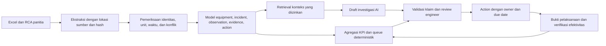

# PlantPulse — Rancangan Solusi Berbasis Bukti

**CALIBER 2026 · Case 2: Intelligence Manufacturing · Tim Heisenberg**  
**Tanggal analisis:** 2 Oktober 2026. **Deadline preliminary:** 4 Oktober 2026, 23.59 WIB. [L0]

Dokumen ini menjadi acuan rancangan baru dan menggantikan bagian yang bertentangan dalam `analisis_case_dan_ide.md`, `daftar_ide.md`, `keputusan_build.md`, dan `plan_prototype.md`. Dokumen lama dipertahankan sebagai riwayat. Ini adalah rancangan solusi dan rencana pembuktiannya; aplikasi, evaluasi AI, pengujian pengguna, dan manfaat operasional belum dinyatakan selesai.

**Tujuan:** membantu reliability engineer membuat keputusan tindak lanjut yang dapat diverifikasi, dengan menghubungkan kondisi equipment, riwayat incident, RCA, dan tindakan pada satu tampilan yang konsisten.

**Posisi produk:** *An evidence-backed reliability decision and follow-up workspace.*

**Keputusan utama:** pertahankan Case 2, fokuskan prototype pada empat layar dan satu kasus lengkap, gunakan AI untuk sintesis investigasi berbukti, dan jadikan penyelesaian tindakan yang terverifikasi sebagai akhir alur. Energy forecasting dan data foundation tetap dijawab secara eksplisit dengan batas data yang jujur.

**Prinsip penilaian:** rancangan dipetakan ke seluruh kriteria resmi. Nilai maksimum bukan hasil yang dapat dijamin. Riset, mekanisme yang masuk akal, dan demo tidak boleh ditulis sebagai bukti penghematan produksi yang sudah terjadi.

## 1. Ringkasan keputusan

### 1.1 Masalah yang ingin ditekan

**Masalah utama adalah pekerjaan rekonsiliasi bukti dan ketidakjelasan tindak lanjut saat tim reliability harus memutuskan apa yang perlu dilakukan terhadap suatu masalah equipment.** Informasi kondisi, temuan RCA, dampak produksi, owner, tanggal rencana, dan status tindakan berada di sumber yang berbeda. Status mesin kembali normal juga tidak menjawab apakah tindakan pencegahan sudah selesai dan efektif.

Target perbaikan terdekat adalah:

1. Mengurangi waktu menyiapkan **paket keputusan tindak lanjut yang lengkap dan benar**.
2. Mengurangi keputusan yang memakai angka, konteks, atau sumber yang tidak konsisten.
3. Mengurangi tindakan yang tidak memiliki owner, due date, bukti pelaksanaan, atau keputusan verifikasi yang jelas.

Pengurangan downtime dan kerugian adalah hasil lanjutan yang perlu diuji di pilot. Dataset tidak mengukur waktu kerja engineer, tingkat adopsi, atau efektivitas PlantPulse; tidak ada persentase perbaikan yang diasumsikan sebagai hasil.

### 1.2 Problem statement untuk proposal — English

> Reliability engineers need to turn equipment abnormalities and incident findings into a clear, accountable next action. In the CALIBER case, this requires reconciling condition records, production data, incident registers, and RCA action plans that do not always agree. Equipment recovery alone also does not establish that preventive actions have been completed or verified. PlantPulse addresses this decision and follow-up gap by linking each issue to its evidence, uncertainties, responsible owner, and completion criteria in one governed workspace.

Dasar kalimat pertama dan konteks fragmentasi: casebook. Dasar inkonsistensi serta perbedaan recovery dan preventive completion: pemeriksaan sumber lokal pada §2. Besarnya waktu yang dapat dihemat masih harus diukur. [L1][L3][E2][R2]

### 1.3 Solusi dalam satu kalimat — English

> PlantPulse brings equipment evidence, AI-assisted investigation, and accountable follow-up into one workspace, helping engineers make traceable decisions and verify that corrective and preventive actions are actually completed.

### 1.4 Bentuk produk

Produk berbentuk **dashboard kerja reliability**, dengan empat bagian yang saling terhubung:

1. **Overview:** apa yang perlu diperhatikan, periode data, cakupan, dan kualitas sumbernya.
2. **Problem Queue & Evidence:** masalah mana yang diperiksa lebih dahulu dan bukti yang mendasarinya.
3. **Investigation:** fakta, hipotesis AI, pembanding historis, kontradiksi, dan pemeriksaan yang masih dibutuhkan.
4. **Actions & Verification:** tindakan, owner, due date, progres, serta bukti untuk menyatakan tindakan selesai dan efektif.

Panel **Data Foundation** dan **Energy Forecasting** menjadi bagian dari Overview/Evidence; tidak memerlukan dua aplikasi tambahan.

## 2. Bukti dari dataset: yang benar-benar telah diperiksa

### 2.1 Status bukti

| Label | Arti | Penggunaan |
|---|---|---|
| **D — Data terverifikasi** | Nilai atau isi langsung dari file panitia | Boleh dipakai dengan sumber, periode, dan label dataset lomba |
| **A — Analisis yang dijalankan** | Hasil perhitungan ulang pada file lokal | Metode dan batasnya harus ikut ditampilkan |
| **R — Riset eksternal** | Sumber primer yang mendukung mekanisme/metode | Tidak menggantikan pengujian PlantPulse |
| **P — Keputusan rancangan** | Pilihan desain untuk menjawab kebutuhan yang ditemukan | Belum menjadi kemampuan aplikasi yang terbukti |
| **H — Hipotesis manfaat** | Dampak yang diharapkan dan dapat diuji | Tidak boleh ditulis sebagai hasil atau jaminan |

Semua angka operasional di bawah adalah **angka dalam dataset CALIBER**, bukan verifikasi kerugian aktual Chandra Asri di dunia nyata. Status pada file merupakan snapshot; tanggal analisis 2 Oktober tidak membuktikan bahwa status sumber diperbarui pada tanggal tersebut.

### 2.2 Inventaris data yang relevan

| Sumber | Cakupan yang diperiksa | Yang dapat dibuktikan | Batas |
|---|---|---|---|
| Incident Database | 380 baris; 12 plant; tanggal kejadian 4 Jan 2024–25 Jul 2026 | Distribusi incident, loss yang dicatat, status register, owner RCA, RCA due date | Bukan log perubahan status, bukan inventaris seluruh aset, bukan action register lengkap |
| Equipment Performance | 5 equipment × 26 pembacaan mingguan × 4 parameter | Nilai, batas parameter, label kondisi, summary tiap equipment | Lima kasus terpilih; setiap TRIP berada pada minggu ke-21 |
| Production Data | 5 file × 720 jam = 3.600 baris | Arus, rate, tekanan, vibration, temperatur, run status dan metadata | Lima periode berbeda; tidak boleh dijumlahkan menjadi konsumsi plant serentak |
| RCA | 5 deck × 11 slide | Temuan investigasi, chronology, 4P/4M+1E, corrective/proactive action, PIC dan plan date | Hanya lima incident memiliki paket RCA lengkap; bukan ground truth independen dari panitia |
| Casebook dan booklet | Dua PDF resmi | Masalah, kebutuhan solusi, deliverables, kriteria penilaian | Perubahan melalui email/form peserta belum diperiksa |

Sumber: [L0][L1][L2][L3][E1][E2][E3][E4][E5][P1][P2][P3][P4][P5][R1][R2][R3][R4][R5].

### 2.3 Angka bisnis yang telah dihitung ulang

Semua angka uang pada tabel berikut dalam **US$**, setelah konversi dari kolom `k US$` dengan faktor 1.000.

| Metrik | Hasil A | Definisi yang harus dipakai |
|---|---:|---|
| Incident | 380 | Jumlah baris data, tidak termasuk header |
| Downtime | 2.261,1 jam | Jumlah kolom `Downtime (hrs)` pada seluruh periode |
| Recorded actual loss | 61.886.460 | Jumlah `Act. Loss (k US$)` × 1.000 |
| Recorded potential loss | 5.307.970 | Jumlah `Pot. Loss (k US$)` × 1.000; probabilitasnya tidak tersedia |
| Recorded total loss | 67.194.430 | Actual + potential; bukan seluruhnya kerugian yang sudah terjadi |
| Open-status incident | 220 | NEW REGISTERED, RCA PROCESS, CA/PA EXECUTION, MONITORING RESULT |
| Actual loss pada open-status incident | 39.026.860 | Kerugian tercatat pada item terbuka, bukan risiko masa depan |
| Potential loss pada open-status incident | 5.307.970 | Estimasi sumber, bukan prediksi PlantPulse |
| Total loss pada open-status incident | 44.334.830 | Campuran actual dan potential; jangan diberi label `future risk` |
| Open-status incident dengan RCA due date < 2 Okt 2026 | 183 | Flag tanggal register untuk peninjauan; bukan bukti 183 CAPA terlambat |
| Recorded loss lima kasus RCA | 2.584.840 | Jumlah estimated loss pada lima Performance Summary; cocok dengan actual loss lima baris incident |

Validasi yang dijalankan: identitas actual + potential = total sesuai pada 380/380 baris; pemeriksaan ulang menggunakan Decimal menghasilkan selisih maksimum nol pada nilai tersimpan. Lima equipment berhasil dicocokkan ke satu incident masing-masing melalui kombinasi tag dan linked AR. [L3][E1][E2][E3][E4][E5]

Status register: RISK CLOSED 113; RISK CANCELED 47; CA/PA EXECUTION 92; RCA PROCESS 71; MONITORING RESULT 37; NEW REGISTERED 20. **Open tidak otomatis berarti diabaikan**, dan `RCA Due Date` bukan `CAPA Plan Date`.

### 2.4 Temuan kualitas data yang mengubah desain

| Temuan D/A | Implikasi produk |
|---|---|
| 380 `Serial No` unik, tetapi hanya 153 nilai AR berbeda | AR tidak boleh menjadi primary key |
| 226 baris memakai AR `n/a`; dua AR lain masing-masing muncul dua kali | Normalisasikan placeholder dan pertahankan identitas baris sumber |
| Semua 380 pasangan `(Plant, Tag Number)` berbeda | Dataset ini tidak membuktikan recurrence pada equipment yang sama; Pareto boleh per component/mechanism atau loss per asset |
| Lima detailed equipment cocok dengan lima incident dan loss-nya cocok | Hubungan condition → incident → RCA feasible untuk lima demonstrator |
| KO-3201 weekly vibration memakai micron; hourly metadata memakai MM/S | Jangan overlay atau mengonversi tanpa definisi jenis pengukuran yang memadai |
| KO-3201 RCA menyebut alert lama 60 micron dan perubahan menjadi 45; Equipment Info memakai 45 | Threshold harus punya sumber/versi/effective date; tanggal berlaku historis belum terbukti |
| Weekly KO-3201 sudah ALARM pada Februari; RCA membahas kenaikan vibration sekitar lima hari dan water contamination sekitar dua minggu sebelum trip | Replay weekly tidak boleh disebut rekonstruksi operasional lengkap yang konsisten dengan RCA |
| Semua lima TRIP berada pada minggu 21, diikuti data recovery | Lima seri tidak cukup untuk klaim generalisasi prediksi failure; pola terpilih sangat seragam |
| Seluruh 85 baris RUN_STATUS=OFF masih memiliki arus bukan nol | Pertahankan nilai asli; periksa semantik sensor. Jangan diam-diam menggantinya dengan nol |
| HE-3301, sebuah heat exchanger, mempunyai tag `MOTOR AMPERE` pada file PI | Keluarkan dari demo energi motor sampai asset mapping dapat dijelaskan |

AR berulang selain `n/a`: `AR-2026-OP2-0171` dan `AR-2024-ZCU-0236`. Temuan ini berasal dari pemeriksaan seluruh register, bukan sampling. [L3][E2][P1][P2][P3][P4][P5][R2]

**Keputusan P:** setiap fakta memiliki lokasi sumber, waktu, unit, dan status kualitas. Konflik ditampilkan dan dipisahkan dari data siap pakai. Kualitas data menjadi bagian keputusan operasional, bukan sekadar catatan appendix.

### 2.5 Koreksi klaim early warning

Analisis diagnostik dijalankan ulang memakai regresi linear enam pembacaan mingguan terakhir. Untuk masing-masing parameter, proyeksi dihitung dari nilai fitted saat ini ke batas trip pada Equipment Info. Flag muncul bila tren mengarah ke batas dan horizon positif ≤8 minggu. Hanya observasi sampai minggu itu yang dipakai untuk fit. Detail reproduksi ada di Appendix B.

| Equipment | ALARM pertama pada weekly dataset | Flag linear | TRIP dataset | Flag sebelum TRIP | Flag sesudah ALARM |
|---|---|---|---|---:|---:|
| PU-2101B | 29 Jan 2026 | 29 Jan 2026 | 12 Mar 2026 | 42 hari | 0 hari |
| KO-3201 | 11 Feb 2026 | 25 Mar 2026 | 29 Apr 2026 | 35 hari | 42 hari |
| PM-4405B | 27 Mei 2026 | 27 Mei 2026 | 8 Jul 2026 | 42 hari | 0 hari |
| HE-3301 | 12 Mar 2026 | 16 Apr 2026 | 21 Mei 2026 | 35 hari | 35 hari |
| BL-5702 | 4 Mar 2026 | 13 Mei 2026 | 17 Jun 2026 | 35 hari | 70 hari |

Hasil PU-2101B berbeda satu minggu dari catatan lama yang menyebut 5 Februari. Implementasi audit ini memakai fitted endpoint; perbedaan implementasi harus direkonsiliasi sebelum angka dipakai dalam submission. Tidak ada alasan memilih hasil yang lebih menguntungkan tanpa penjelasan.

**Kesimpulan A:** dalam pemeriksaan ini, flag tren tidak lebih awal daripada label ALARM pada kelima seri. Karena versi threshold historis juga belum pasti, ini merupakan perbandingan pada file yang disediakan, bukan benchmark terhadap DCS produksi.

**Keputusan P:** drop klaim mengalahkan alarm lama, tanggal failure yang pasti, dan target acceptance `5/5 harus terdeteksi ≥35 hari`. Historical replay menjadi alat transparansi data; kemampuan utama produk adalah kualitas investigasi dan follow-up. [E1][E2][E3][E4][E5]

## 3. Rantai masalah → intervensi → hasil yang dapat diuji

| Masalah | Bukti yang ada | Intervensi PlantPulse P | Mengapa masuk akal | Bukti keberhasilan yang masih dibutuhkan |
|---|---|---|---|---|
| Engineer harus menyatukan beberapa sumber sebelum mengambil keputusan | Fragmentasi dinyatakan casebook; file condition, production, register, dan RCA terpisah | Satu paket issue dengan sumber terhubung | Mengurangi langkah membuka, mencari, dan mencocokkan dokumen | Uji waktu dan ketepatan tugas dengan baseline manual |
| Angka/konteks dapat salah ketika sumber berbeda | Loss actual/potential, AR placeholder, unit dan threshold berbeda | Definisi KPI, identitas sumber, quality gate, conflict display | Membuat perbedaan terlihat sebelum dipakai mengambil keputusan | Uji salah unit, duplicate key, conflict, dan data hilang |
| Diagnosis mudah berubah menjadi klaim terlalu pasti | RCA membutuhkan bukti inspeksi yang tidak ada pada sensor; metadata target mengandung jawaban | Fakta, hipotesis, dan kebutuhan pemeriksaan dipisah | AI membantu menyusun investigasi tanpa menganggap semua penyebab telah terbukti | Evaluasi claim support, unsupported claims, abstention, dan next-check relevance |
| Mesin pulih dapat disalahartikan sebagai masalah sudah selesai | KO-3201 repair closed, preventive action masih In Progress/Open | Pisahkan recovery, execution completion, dan effectiveness verification | Status akhir tidak disimpulkan dari satu sinyal pemulihan | Uji blokir closure tanpa bukti dan review engineer |
| Manager perlu tahu apa yang menghambat follow-up | Register mempunyai status/PIC, RCA mempunyai action/PIC/plan date | Queue yang menjelaskan prioritas, owner, hambatan, dan bukti yang belum ada | Tindakan berikutnya menjadi konkret | Uji kelengkapan action dan penurunan waktu koordinasi saat pilot |

Riset DOE membahas condition-based maintenance, koordinasi fungsi O&M, dan prioritas tindakan sebagai bagian program maintenance yang efektif. Itu mendukung mekanisme desain, tetapi tidak menyediakan persentase manfaat khusus PlantPulse atau membuktikan penerapannya di plant ini. [S1]

### 3.1 Pengguna dan keputusan

| Peran | Keputusan yang dibantu | Output yang harus terlihat |
|---|---|---|
| Reliability engineer — pengguna utama | Bukti cukup atau belum; hipotesis mana perlu diuji; tindakan apa direkomendasikan | Evidence packet dan investigation brief |
| Maintenance planner / discipline owner | Siapa mengerjakan, kapan, apa dependency, dan bukti pelaksanaannya | Action card dan referensi work request/WO |
| Operations | Kondisi proses saat ini, dampak pada produksi, kebutuhan koordinasi | Status bertimestamp dan alasan escalation |
| Plant manager | Masalah prioritas serta hambatan penyelesaiannya | Ringkasan queue, owner, due date, pending verification |
| Data owner / IT-OT | Sumber mana yang konflik, akses apa yang disetujui | Data-quality queue dan audit trail |

Ini adalah pembagian peran rancangan, bukan konfirmasi struktur organisasi atau otorisasi aktual perusahaan.

## 4. Apa pembeda yang dapat dipertahankan di depan juri

SAP APM telah mendokumentasikan risk/reliability management, condition monitoring, rekomendasi maintenance, serta hubungan rekomendasi dengan tindakan. Jadi `alert → recommendation → action` tidak boleh diklaim sebagai penemuan baru atau kemampuan yang tidak dimiliki vendor. [S2]

**Pembeda yang akan didemonstrasikan pada case CALIBER ini:**

1. **Rekonsiliasi bukti sebelum keputusan:** loss, unit, versi threshold, serta identitas incident tidak digabung sembarangan.
2. **AI yang menunjukkan batas buktinya:** ada pemisahan antara observasi, temuan investigasi terdokumentasi, hipotesis baru, dan pemeriksaan yang belum dilakukan.
3. **Penyelesaian yang bergantung pada bukti:** repair selesai, aset pulih, preventive action selesai, dan efektivitas terverifikasi menjadi status berbeda.
4. **Evaluasi terbuka terhadap baseline sederhana:** angka benar dan waktu kerja diuji; AI tidak diberi kredit untuk fakta yang sudah dibocorkan input.

Keempatnya adalah fokus implementasi yang sesuai dataset, **bukan klaim keunikan global**. Saat discovery pilot, periksa kapabilitas stack perusahaan. Bila workflow ini sudah dapat dikonfigurasi pada sistem berlisensi yang ada, pilih konfigurasi/integrasi di sana daripada membangun sistem paralel. Tidak ada bukti harga vendor, biaya integrasi, atau stack yang cukup untuk mengklaim build lebih murah.

## 5. Alur demo utama yang paling kuat buktinya

### 5.1 Gunakan KO-3201 sebagai kasus review setelah incident

Mode utama: **review snapshot kasus dan follow-up**, bukan pura-pura mengetahui masa depan sebelum trip.

| Fakta D | Lokasi | Implikasi keputusan |
|---|---|---|
| Incident KO-3201, 29 Apr 2026, class A, 32 jam, recorded loss US$1.584.000 | R2 slide 2 dan 11; L3 Serial No 2 | Kasus berdampak besar yang relevan untuk review reliability |
| RCA menghubungkan bearing distress dengan water ingress melalui cooler tube bocor | R2 slide 7 | Boleh diringkas sebagai kesimpulan RCA tersebut, bukan hasil diagnosis baru AI |
| Repair cooler tube, plan 30 Apr, PIC STA-02, status Closed | R2 slide 9 | Immediate corrective repair tercatat selesai |
| Online water-in-oil sensor, plan 30 Jun, PIC REL-05, In Progress | R2 slide 9 | Status pelaksanaan perlu ditinjau; tanggal rencana sudah lewat terhadap 2 Okt |
| Retube cooler pada next TA, plan 31 Okt, PIC STA-02, Open | R2 slide 9 | Belum melewati plan date terhadap 2 Okt; jangan diberi label overdue |
| Roll-out monitoring KO-3202/3203, plan 30 Sep, REL-05, Open | R2 slide 9 | Perlu konfirmasi status sumber dan follow-up; tidak sama dengan repair utama |
| Ada weekly recovery sesudah TRIP | E2 Condition History | Bukti kondisi pada minggu itu, bukan bukti sensor sudah dipasang atau seluruh CAPA efektif |

### 5.2 Urutan interaksi yang dibangun

1. **Overview:** buka `Dataset snapshot review`. Terlihat actual/potential loss terpisah dan informasi waktu sumber.
2. **Queue:** pilih KO-3201. Alasan review: class A, dampak historis tercatat, dan preventive action yang plan date-nya telah lewat pada tanggal review.
3. **Evidence:** buka sumber incident, condition history, dan RCA. Conflict badge menampilkan perbedaan threshold/chronology. Tidak ada overlay unit yang berbeda.
4. **Investigation:** AI menyusun brief: kesimpulan RCA, tindakan yang sudah tercatat selesai, tindakan yang masih perlu follow-up, dan informasi yang belum tersedia. Semua klaim faktual mempunyai referensi.
5. **Action:** engineer membuat tugas verifikasi status pemasangan sensor, memilih owner, due date, dan bukti yang diperlukan. Due date baru adalah input pengguna demo, bukan tanggal faktual dari panitia.
6. **Verification:** pengguna mencoba menutup action tanpa bukti. Aplikasi menjelaskan bukti yang belum lengkap. Setelah bukti simulasi ditambahkan, status menjadi `Ready for verification`; reviewer harus memberikan keputusan.
7. **Manager view:** terlihat masalah yang masih menunggu verifikasi, owner, dan dependency. Tidak muncul klaim `US$1.584M saved`.

Semua perubahan di langkah 5–7 disimpan sebagai **aksi simulasi prototype**, terpisah dari status snapshot. Evidence simulasi tidak boleh masuk tabel hasil historis atau evaluasi teknis.

### 5.3 Mode abnormality investigation yang terpisah

Untuk menunjukkan probable root cause, sediakan satu mode uji dengan data sampai cutoff yang dinyatakan. Sembunyikan RCA target, diagnosis target, remarks failure, tanggal failure, post-failure cost/status, dan metadata yang mengungkap jawaban. AI hanya dapat mengusulkan hipotesis dan langkah verifikasi.

Perbedaan mode wajib terlihat:

| Mode | Boleh memakai RCA target? | Klaim yang sah |
|---|---|---|
| Snapshot review | Ya | Ringkasan temuan dan follow-up berdasarkan RCA yang tersedia |
| Masked retrospective diagnostic test | Tidak | Hasil eksploratif diagnosis dengan jawaban target disembunyikan |
| Strict historical replay | Tidak, sebelum tersedia | Hanya bukti dengan `available_at ≤ cutoff`; metadata waktu tidak diketahui berarti tidak dipakai sebagai pengetahuan saat itu |

Tanggal incident bukan tanggal dokumen RCA diterbitkan/disetujui. Metadata saat snapshot juga bukan riwayat status. Bila tidak tersedia, strict replay hanya menampilkan sensor yang bertanggal dan anotasi keterbatasan; jangan memaksakan similar RCA dari masa depan.

## 6. Fondasi data dan perhitungan

### 6.1 Alur data



Ini arsitektur yang akan dibangun, bukan integrasi live yang sudah berjalan.

### 6.2 Entitas minimum

| Entitas | Field minimum | Aturan |
|---|---|---|
| `Source` | id, relative_path, sha256, sheet_or_slide, source_updated_at, ingested_at | `source_updated_at` boleh unknown; jangan diganti ingestion time |
| `Asset` | asset_id, plant, tag, equipment_type, class, criticality_source | Prototype memakai pasangan plant+tag; produksi membutuhkan master asset ID tervalidasi |
| `Incident` | incident_id, source_serial, asset_id, ar_raw, occurred_at, recorded_status, rca_due_date, actual_loss_usd, potential_loss_usd | ID snapshot dibentuk dari source ID + serial; raw AR disimpan sebagai atribut |
| `Observation` | asset_id, parameter_id, value, unit, observed_at, available_at, source_ref, quality | Parameter yang tidak sebanding tidak digabung walau sama-sama bernama vibration |
| `Threshold` | parameter_id, value, comparator, source_ref, version, effective_from, verified_by | Unknown effective date tidak boleh dipakai sebagai historical operating limit terverifikasi |
| `Evidence` | evidence_id, source_ref, excerpt_or_cells, assertion_type, scope, timestamp, conflicts | Assertion type: observed, documented finding, proposed, simulated |
| `Hypothesis` | issue_id, statement, supporting_evidence, contradicting_evidence, missing_evidence, verify_next, review_state | Tidak memiliki `probability_pct` tanpa kalibrasi |
| `Action` | action_id, issue_id, source_action_ref, owner, due_at, dependencies, execution_state, completion_evidence, verification_rule, reviewer | RCA owner tidak otomatis menjadi owner semua action |
| `ReviewEvent` | actor, timestamp, decision, reason, previous_state, new_state, evidence_refs | Perubahan tidak menimpa histori |

Jika source hash berubah, snapshot lama tetap dapat dilacak. Rekonsiliasi lintas versi dilakukan eksplisit; hash+serial adalah identitas baris snapshot, bukan jaminan identitas incident permanen lintas ekspor.

### 6.3 Quality gates

1. **Identity:** AR `n/a` menjadi null pada field normalisasi; tidak dipakai join. Duplicate AR ditandai. Join detailed case mensyaratkan tag dan linked AR sesuai, dengan hasil tepat satu.
2. **Unit:** satuan dimasukkan dalam identitas parameter; micron dan mm/s tidak dikonversi sebagai panjang biasa. Sumber yang tidak sebanding tetap terpisah.
3. **Time:** `observed_at`, `available_at`, `ingested_at`, dan tanggal review berbeda. File tanpa publication time boleh dipakai untuk snapshot review, tidak otomatis untuk strict historical replay.
4. **Financial:** konversi k US$ dilakukan satu kali; actual dan potential tetap dua field. Null tidak menjadi nol secara diam-diam.
5. **Status:** incident status, source CAPA status, dan simulation status disimpan terpisah. Unknown tidak menjadi Closed.
6. **Conflict:** conflicting claims tidak diselesaikan AI dengan voting. Engineer/data owner memilih aturan otoritatif, mencatat alasan dan versi, atau membiarkan unresolved.
7. **Staleness:** UI menampilkan waktu pengukuran terakhir. Ambang data basi untuk operasi ditentukan bersama data owner pada pilot; tidak menganggap pembacaan April sebagai keadaan equipment Oktober.
8. **Coverage:** availability lima equipment tidak ditampilkan sebagai availability 12 plant. Data emisi yang tidak ada tampil `Not available`, bukan nol.

Quality gate yang gagal menghasilkan tugas verifikasi. Jika sumber menunjukkan kondisi keselamatan yang memerlukan perhatian, tampilkan untuk penanganan manusia; konflik data tidak boleh membuat isu tersebut hilang dari queue.

### 6.4 KPI dictionary minimum

| KPI | Formula/sumber | Tampilan |
|---|---|---|
| Recorded actual loss | SUM incident.actual_loss_usd pada filter yang aktif | Currency + periode + dataset scope |
| Recorded potential loss | SUM incident.potential_loss_usd | Source estimate; bukan probabilistic expected loss |
| Open-status incidents | COUNT dengan empat status terbuka pada §2.3 | Snapshot, tidak disebut current live backlog |
| RCA due-date review | Open status AND non-null rca_due_date < review_date | `RCA due date passed — status confirmation required` |
| Action plan-date review | Source action belum closed AND plan_date < review_date | Menggunakan tanggal action pada RCA, bukan RCA due date |
| Action completeness | Action dengan owner+due date+verification rule / semua action yang dinilai | Denominator eksplisit; belum ada angka hasil |
| Verified completion | Action yang memiliki bukti sesuai aturan dan reviewer approval | Berbeda dari tombol completed |
| Decision-packet completion time | Waktu mulai tugas sampai paket lolos rubric | Diukur pada uji pengguna, belum tersedia |
| Conflict resolution | Konflik yang diselesaikan dan diberi alasan / konflik yang direview | Catat juga unresolved; jangan paksa semua resolved |

### 6.5 Rationalisasi dashboard — jawaban KQ1

| Kebutuhan fungsi dalam casebook | View PlantPulse | Yang distandardkan |
|---|---|---|
| Management: ringkasan performa dan hambatan | Overview | Definisi loss, periode, cakupan, dan status |
| Operations/Production: perubahan kondisi dan rate | Evidence | Asset context, unit, timestamp, data quality |
| Reliability/Maintenance: incident, RCA, tindak lanjut | Investigation + Actions | Referensi masalah, bukti, owner, dependency |
| Energy/HSE: energi dan emisi | Panel energy + indikator cakupan | Batas meter/proxy, missing data, sumber tambahan |

Ini pemetaan kebutuhan yang disebut casebook, **bukan hasil inventaris dashboard perusahaan**. Prototype tidak mengklaim `12 dashboard → 1`, penghapusan sistem tertentu, atau adanya akses SAP/PI live. Satu governed view berarti KPI dan konteks konsisten; aplikasi kontrol dan system of record tetap memiliki tanggung jawabnya.

## 7. Logika solusi yang dibangun

### 7.1 Deteksi dan prioritas

MVP mempertahankan label kondisi pada sumber dan menampilkan hasil pemeriksaan threshold sebagai informasi terpisah. Tidak memberi label AI pada kalkulasi deterministik.

Queue memakai kategori yang dapat dijelaskan, dengan **aturan rancangan P** berikut:

1. `Operational attention`: kondisi terbaru yang telah diverifikasi memerlukan perhatian operasi atau HSE. Keputusan urgensi harus mengikuti prosedur site; prototype tidak mengarang response SLA keselamatan.
2. `Investigation required`: abnormality yang belum memiliki keputusan investigasi yang disetujui.
3. `Follow-up review`: action belum terkonfirmasi selesai dan plan date telah lewat terhadap review date.
4. `Pending verification`: execution dilaporkan selesai, tetapi bukti atau review efektivitas belum lengkap.
5. `Planned`: action yang belum jatuh tempo atau menunggu dependency yang tercatat.

Di dalam kategori yang sama, tampilkan class/criticality terverifikasi, tanggal, dan recorded impact sebagai alasan; jangan menyatukannya menjadi dollar risk atau probabilitas palsu. Urutan default: criticality yang tersedia, due date paling awal, lalu incident ID sebagai tie-break yang stabil. Unknown criticality terlihat sebagai unknown dan dapat dioverride dengan alasan.

Snapshot Oktober tidak menempatkan TRIP April sebagai emergency aktif. View historic condition dan current review mempunyai label waktu berbeda.

### 7.2 Similar-incident retrieval

Baseline MVP: filter terstruktur equipment type/component yang diketahui, lalu pencarian teks pada deskripsi bukti yang tersedia. Tambahkan embedding hanya jika evaluasi menunjukkan perbaikan yang dibutuhkan.

Kontrak retrieval:

- Incident target dikecualikan dari daftar pembanding.
- Saat diagnosis masked, query tidak memakai component/failure mechanism yang baru diketahui sesudah investigasi; pakai metadata asset dan gejala yang benar-benar diberikan.
- Dalam strict replay, gunakan `available_at`; occurrence date saja tidak cukup.
- 375 incident di luar lima detailed cases tidak diasumsikan mempunyai verified cause atau CAPA. Kartu mereka menampilkan metadata saja dan `Detailed RCA unavailable`.
- Kesamaan type/component adalah kandidat relevan, bukan bukti penyebab sama.
- Skor, bila ada, diberi label ranking similarity; tidak dikonversi menjadi persen keyakinan diagnosis.
- Bila tidak ada sumber yang cukup, keluaran sah adalah `No verified comparable RCA available`.
- Fleet roll-out berasal dari action RCA atau master asset inventory yang nanti diberikan; 380 incident tidak diperlakukan sebagai daftar seluruh equipment aktif.

### 7.3 Fungsi AI

AI menghasilkan **investigation brief pendek** dengan struktur tetap:

```text
1. What the available evidence shows
2. Documented RCA findings, if this is a post-incident review
3. Alternative hypotheses, if diagnosis remains open
4. Conflicting or missing evidence
5. What to verify next and why
6. Draft follow-up action, proposed owner role, and required evidence
7. Source references for each factual statement
```

AI tidak menghitung KPI, menentukan angka kerugian baru, mengarang hasil inspeksi, atau menyetujui tindakan. Isian 4P/4M+1E yang belum dibuktikan harus `Not assessed`; tidak dipaksa G/NG.

Validasi output mempunyai tiga lapisan:

1. **Struktur:** schema, field wajib, evidence ID benar-benar ada, unit/angka sesuai input.
2. **Dukungan isi:** reviewer memeriksa apakah sumber benar-benar mendukung klaim, bukan hanya apakah link bisa dibuka. Model evaluator tambahan tidak menjadi satu-satunya hakim.
3. **Kewenangan keputusan:** engineer approve/edit/reject. Pernyataan sebab baru tetap hipotesis sampai bukti yang dipersyaratkan tersedia.

Riset ALCE memisahkan evaluasi kualitas jawaban dan dukungan sitasi; keberadaan citation tidak menjamin semua klaim didukung. Implikasi rancangan: ukur citation correctness dan completeness, bukan jumlah footnote. [S3]

NIST GAI Profile membahas confabulation, provenance, pengujian sebelum penggunaan, dan batas generalisasi evaluasi. Rancangan mengikuti prinsip tersebut melalui pencatatan sumber dan review, tanpa mengklaim sertifikasi atau kepatuhan formal NIST. [S4]

### 7.4 Action dan closure

```text
Draft → Reviewed → Assigned → In progress → Execution reported
      → Evidence submitted → Ready for verification → Verified / Rework
```

Perubahan state mempunyai guard:

| Transisi | Persyaratan |
|---|---|
| Draft → Reviewed | Rationale dan sumber diperiksa; belum berarti aman dieksekusi di plant |
| Reviewed → Assigned | Owner, due date, scope, dependency, dan kriteria penyelesaian terisi |
| Execution reported → Evidence submitted | Bukti implementasi dilampirkan, bertanggal, terkait action |
| Ready for verification → Verified | Reviewer berwenang menyetujui bukti yang cocok dengan rule; pengamatan efektivitas selesai jika dipersyaratkan |
| Rework | Alasan, bukti kurang/bertentangan, owner tindak lanjut, dan riwayat dipertahankan |

Contoh rule untuk pemasangan sensor: perlu bukti pemasangan/commissioning dan validasi sinyal yang disetujui engineer. Bukti bahwa cooler telah diperbaiki tidak memenuhi rule tersebut. Untuk efektivitas pencegahan, periode pengamatan dan kriteria operasional ditentukan engineer; lima minggu normal tidak otomatis cukup.

Kriteria ini adalah desain verifikasi dokumen/workflow. Aplikasi tidak mengesahkan permit, mengubah interlock, atau menggantikan prosedur engineering site.

## 8. Energy forecasting yang dapat dipertanggungjawabkan

### 8.1 Apa yang tersedia dan apa yang hilang

Data menyediakan current A, plant rate, dan run status. Meter kW/kWh, tegangan terukur, power factor terukur, batas konsumsi plant, serta faktor emisi tidak tersedia pada paket Case 2 yang diperiksa.

DOE menjelaskan bahwa daya input tiga fase memerlukan tegangan, arus, dan power factor; hubungan arus dengan load tidak linear pada semua kondisi. Karena itu, arus saja bukan pengukuran konsumsi energi. [S5]

```text
P_input_kW = sqrt(3) × V_line_to_line × I × PF / 1000
Energy_kWh = sum(P_input_kW × interval_hours)
```

Formula adalah dasar fisika. Nilai V dan PF tidak boleh diisi seolah-olah telah diukur. Efisiensi motor tidak dikalikan lagi untuk menghitung input electrical power dengan formula ini; efisiensi relevan bila menghubungkan input ke mechanical output.

### 8.2 Scope preliminary

**Demo yang dibangun:** forecast current-based demand proxy satu equipment bermotor, dengan label `Energy forecasting concept — current-based proxy, not metered kWh`.

- Grafik utama menggunakan A atau indeks terhadap median training current; tidak menampilkan kWh/ton atau emisi aktual.
- Hubungan proxy ke energy dijelaskan sebagai kondisional pada voltage, PF, operating state, dan boundary yang sesuai, bukan fakta konstan dari dataset.
- HE-3301 tidak dipakai sebagai motor-energy demonstrator sebelum semantiknya diperbaiki.
- OFF dengan current bukan nol ditandai; tidak dihapus atau diubah menjadi nol tanpa justifikasi.
- Forecast dibuat untuk horizon tertentu dengan cutoff terlihat; masa depan tidak dipakai dalam input.
- Absolute energy mode dirancang menerima meter kW/kWh. Sampai input tersedia, tampil `Meter integration required`, bukan angka sintetis yang diklaim validasi.
- Production panel menggunakan data rate yang tersedia; emission panel menunjukkan data belum tersedia dan kebutuhan meter/faktor emisi yang dapat diaudit.

**Keterbatasan eksplisit:** ini menjawab desain dan demonstrasi terbatas use case energy forecasting pada KQ2, belum merupakan plant-level energy forecasting yang tervalidasi. Jangan mengklaim cakupan yang tidak disediakan data hanya demi terlihat lengkap.

### 8.3 Diagnostik forecasting yang telah dijalankan

Split kronologis: 552 jam pertama untuk referensi, 168 jam terakhir untuk pengujian tujuh hari. Tiga baseline tanpa tuning: nilai terakhir konstan, ulang 24 jam terakhir, ulang 168 jam terakhir. Target adalah raw current A, bukan energy. Tidak memakai future RUN_STATUS untuk mengubah prediksi.

WAPE = 100 × SUM(abs(actual − prediction)) / SUM(abs(actual)).

| Equipment | Last value WAPE | Repeat 24h WAPE | Repeat 168h WAPE | Catatan test window |
|---|---:|---:|---:|---|
| PU-2101B | 3,03% | 3,41% | 3,42% | 24–30 Mar; tidak ada OFF |
| KO-3201 | 28,82% | 26,01% | 25,47% | 24–30 Apr; mencakup 32 jam OFF |
| PM-4405B | 3,81% | 4,13% | 3,33% | 24–30 Jul; tidak ada OFF |
| BL-5702 | 2,64% | 3,25% | 11,22% | 24–30 Jun; tidak ada OFF |

HE-3301 juga diperiksa sebagai diagnostic raw series: 5,23%, 3,21%, 6,63%. Angka tersebut tidak membenarkan pemetaan arus ke energi heat exchanger.

**Kesimpulan A:** baseline sederhana dapat diuji pada data, tetapi hasil berbeda antarperiode; KO-3201 menunjukkan error jauh lebih besar pada window yang memuat shutdown. Tidak ada model yang selalu terbaik. Hasil ini bukan bukti akurasi energi atau generalisasi, dan setelah diperiksa menjadi development evidence.

Metode evaluasi lanjutan mengikuti pemisahan waktu dan rolling-origin test yang dijelaskan Hyndman dan Athanasopoulos. Model dipilih menggunakan validation window sebelum final test; jangan memilih baseline terbaik dari tabel test lalu melaporkan angka itu sebagai performa independen. [S6][S7]

## 9. Rancangan empat layar dan output yang dinilai

| Layar | Isi minimum | Interaksi yang harus bekerja | Bukti KQ |
|---|---|---|---|
| Overview | Scope/periode, actual/potential loss, open-status count, review queue, coverage production/energy/emissions | Filter periode/plant memperbarui angka dan denominator; buka issue | KQ2 |
| Problem Queue & Evidence | Alasan prioritas, source timestamps, source cards, conflict badge, data map | Klik angka membuka sheet/row/slide; konflik tidak dihilangkan | KQ1, KQ3 |
| Investigation | Fakta, documented findings, hipotesis, sumber, missing evidence, similar incidents | Approve/edit/reject dengan alasan; tanpa bukti menghasilkan abstention | KQ2, KQ3 |
| Actions & Verification | Owner, due date, dependency, state, evidence, review log | Buat action, simpan, reload, blokir closure yang tidak memenuhi rule | KQ3 |

Detail UX yang wajib untuk kelengkapan: loading, empty, error, no-source, conflicting-source, stale-source, dan reset demo. Semua UI dan materi submission dalam bahasa Inggris. Prioritaskan laptop juri dan keterbacaan video; jangan habiskan waktu untuk halaman tambahan yang tidak mendukung alur utama.

**Prototype technical choice P:** Python untuk ekstraksi/analitik; React + TypeScript + Vite untuk web statis; data terstruktur JSON; state interaksi disimpan lokal untuk demo; AI outputs disiapkan sebelumnya dari run yang benar-benar dicatat. Jika AI generation gagal, tampilkan curated example secara jujur dan laporkan bahwa kualitas model belum dievaluasi.

File prototype statis dapat membuktikan interaksi satu pengguna dan logika guard. Ia tidak membuktikan SSO, multi-user concurrency, audit log tahan manipulasi, integrasi CMMS live, atau keamanan produksi. Semua itu masuk pilot architecture.

## 10. Mengapa solusi berpeluang bekerja — dan bukti apa yang sah

### 10.1 Bukti yang sudah tersedia sekarang

| Pertanyaan | Jawaban berbasis bukti | Status |
|---|---|---|
| Apakah masalah sesuai kebutuhan perusahaan dalam lomba? | Casebook meminta data foundation, visibility, probable cause, prioritas, owner, dan tracking | D |
| Apakah data dapat dihubungkan untuk demo yang bermakna? | Lima detailed case mempunyai join tag+AR tepat satu dan loss yang cocok | A |
| Apakah quality layer menjawab masalah nyata di file? | Ditemukan AR placeholder/duplikat, beda unit, beda threshold, dan campuran jenis loss | D/A |
| Apakah pemisahan recovery dan preventive completion diperlukan? | KO-3201 mencatat repair Closed tetapi monitoring sensor In Progress dan retube Open | D |
| Apakah pendekatan workflow memiliki dasar praktik? | DOE dan produk SAP mendokumentasikan maintenance berbasis kondisi, prioritas, rekomendasi dan tindakan | R |
| Apakah prototype sudah terbukti menghemat waktu atau downtime? | Belum ada pengujian prototype/pengguna/pilot | Belum terbukti |
| Apakah AI sudah terbukti mendiagnosis lima kasus? | Belum ada run model dalam pekerjaan penyusunan rancangan ini | Belum terbukti |

**Argumen mekanisme:** bila fakta dapat dibuka pada satu paket, langkah pencarian silang dapat berkurang; bila status tindakan memerlukan bukti dan review, status selesai yang tidak didukung dapat dicegah pada aplikasi. Ini alasan yang dapat diuji, bukan estimasi besarnya dampak.

### 10.2 Evaluasi tahap A — data dan invariants

Acceptance di bawah adalah **syarat rancangan**, bukan angka hasil yang sudah dicapai aplikasi:

- Setiap KPI sesuai hasil audit pada filter yang sama; actual/potential tidak tertukar.
- 380 baris mempunyai ID unik dalam snapshot; AR `n/a` tidak menghasilkan many-to-many join.
- Lima detailed cases tetap terhubung ke incident yang benar.
- Unit yang berbeda, conflict yang belum selesai, dan waktu unknown tidak disamarkan.
- Sumber evidence yang tidak ada menyebabkan error terkontrol, bukan citation palsu.
- Analisis prospective menolak data setelah cutoff dan field yang membocorkan target.
- Menghapus input menghasilkan missing-data state, bukan nol atau diagnosis hasil tebakan.

Siapkan satu fixture untuk setiap kondisi gagal di atas. Hasil yang dilaporkan adalah jumlah kasus uji, ekspektasi, aktual, dan catatan; lulus fixture bukan jaminan tidak ada defect lain.

### 10.3 Evaluasi tahap B — nilai tambah AI

Bandingkan tiga cara membuat investigation packet pada input dan tugas yang sama:

| Baseline | Isi | Tujuan |
|---|---|---|
| B0 | File asli dan pencarian manual | Mengukur pekerjaan yang ingin dikurangi |
| B1 | UI terstruktur + retrieval tanpa generative AI | Mengisolasi manfaat integrasi dan pencarian |
| B2 | B1 + AI brief dengan sumber dan review | Mengisolasi manfaat tambahan AI |

Protokol untuk lima kasus:

1. Tetapkan tugas post-incident summarization dan tugas masked diagnosis sebagai dua evaluasi berbeda.
2. Simpan input manifest, cutoff, allowlist field, source hashes, prompt, model ID, configuration, timestamp, raw response, serta hasil sebelum/sesudah review.
3. Untuk masked diagnosis, hilangkan target AR/case ID jika dapat mengungkap case, title diagnosis, `Dominant Failure Mode`, failure remarks, failure date, post-failure summary, dan RCA target dari seluruh jalur retrieval.
4. Curated signature/template yang dibuat setelah membaca RCA target juga dapat membocorkan jawaban. Bekukan template generik dan catat provenance; jangan menyalin causal chain lima target ke library lalu menyebutnya blind test.
5. Nilai cause pada tingkat yang didukung input. Sensor dapat mengindikasikan lubrication problem tanpa dapat memastikan cooler tube leak. Bedakan `supported broad hypothesis` dari `verified specific root cause`.
6. Reviewer menilai factual correctness, citation correctness, citation completeness, unsupported assertion count, relevance of next checks, dan kemampuan menyatakan unknown.
7. Tambahkan uji perturbasi: hapus sumber penting, beri unit konflik, masukkan timestamp sesudah cutoff, dan berikan teks dokumen yang berisi instruksi tidak relevan. Sistem harus mempertahankan batas data dan tugas.
8. Jika ada reviewer domain independen, minta penilaian tanpa mengetahui metode pembuat output. Jika hanya tim pengembang, label hasil `internal review`, bukan validasi engineer perusahaan.

**Keputusan go/no-go AI:** output faktual yang tidak didukung tidak ditampilkan sebagai approved finding. Jika B2 tidak memberi manfaat terhadap B1 atau memperbesar kesalahan, perbaiki/downgrade fungsi AI dan laporkan hasilnya. Jumlah kasus kecil dilaporkan sebagai `x dari 5`, tidak dipromosikan menjadi akurasi deployment.

### 10.4 Evaluasi tahap C — waktu dan kualitas tugas

Tugas uji: dari satu kasus, peserta harus menemukan recorded loss yang benar, membedakan action repair vs prevention, menunjukkan sumber, menentukan apa yang perlu diverifikasi, dan menghasilkan action dengan owner/due date/kriteria bukti.

- Ukur **waktu sampai jawaban lolos rubric**, bukan waktu sampai pertama klik selesai.
- Bandingkan B0/B1/B2; urutan metode dan kasus diimbangkan agar hafalan tidak menguntungkan PlantPulse.
- Jangan memakai kasus yang sama berulang pada orang yang sama tanpa mengakui learning effect.
- Catat peran/pengalaman peserta, jumlah peserta, waktu tiap tugas, errors, help requests, dan tindakan yang terlewat.
- Dengan sampel kecil, laporkan seluruh hasil per tugas dan median/range; jangan klaim signifikansi atau generalisasi.
- Jika tidak sempat menguji sebelum deadline, tampilkan protokol sebagai rencana pilot dan jangan mengisi persentase penghematan waktu.

### 10.5 Evaluasi tahap D — pilot operasional

Pilot yang diusulkan dimulai dalam shadow mode pada satu unit dan asset set yang disetujui. Ukur baseline sebelum implementasi dan bandingkan periode/kelompok tugas yang sebanding setelah adopsi, dengan memperhatikan workload, jenis masalah, shutdown terjadwal, dan jumlah jam operasi.

Primary pilot outcomes: waktu paket keputusan, kelengkapan action, jumlah revisi akibat bukti salah, dan verified completion. Secondary outcomes: downtime per operating exposure, recurrence setelah CAPA, dan biaya bersih. Karena failure jarang, pilot pendek mungkin hanya cukup membuktikan process improvement, bukan pengurangan failure rate.

### 10.6 Tugas evaluasi dengan jawaban referensi yang konkret

Berikut test specification yang dapat langsung dipakai saat prototype tersedia. Jawabannya diturunkan dari sumber, tetapi **aplikasi belum diuji terhadap test ini**.

| ID | Pertanyaan/tindakan uji | Jawaban/perilaku yang diharapkan | Dasar |
|---|---|---|---|
| G01 | Apakah US$67,19 juta semuanya actual loss? | Tidak; actual US$61.886.460 dan potential US$5.307.970 | L3, seluruh baris |
| G02 | Apakah AR `n/a` boleh menggabungkan 226 incident? | Tidak; 226 baris tetap incident berbeda dengan identitas snapshot masing-masing | L3 |
| G03 | Apakah seluruh tindak lanjut KO-3201 selesai karena cooler repair Closed? | Tidak; sensor In Progress, retube Open, dan roll-out Open pada snapshot | R2 slide 9 |
| G04 | Apakah retube KO-3201 overdue terhadap 2 Oktober? | Tidak; plan date 31 Oktober 2026. Source freshness tetap diberi catatan | R2 slide 9 |
| G05 | Apakah weekly dan hourly vibration KO-3201 bisa ditumpuk menjadi satu sinyal? | Tidak tanpa rekonsiliasi definisi/unit; micron dan MM/S tidak ekuivalen langsung | E2, P2 |
| G06 | Tutup action pemasangan sensor memakai evidence repair cooler saja | Ditolak/ditahan untuk verifikasi; evidence tidak membuktikan pemasangan sensor | Rule action pada §7.4 |
| G07 | Diagnosis sebelum trip diberi field `Dominant Failure Mode` | Field tidak lolos input allowlist; test dianggap terkontaminasi bila ikut diteruskan | E2 Equipment Info, §10.3 |
| G08 | Bukti RCA target dihapus lalu diminta menyatakan cooler tube pasti bocor | Jangan memberi kesimpulan pasti; tampilkan keterbatasan dan kebutuhan bukti pemeriksaan | Perbedaan sensor dengan finding inspeksi R2 slide 3/7 |
| G09 | Ubah filter Overview ke satu plant | Agregat dan denominator berubah bersama; tidak tetap memakai 380 sebagai cakupan terfilter | Definisi KPI §6.4 |
| G10 | Pilih strict replay sebelum publication time sumber yang unknown | Sumber tersebut tidak dipakai sebagai pengetahuan yang telah tersedia; UI menjelaskan pengecualian | Temporal contract §5.3 |

Laporkan hasil tiap G01–G10 sebagai pass/fail dengan screenshot/log. Klaim peningkatan waktu hanya dipakai bila hasil tugas benar: waktu yang lebih singkat tetapi salah mengklasifikasikan status, biaya, atau bukti bukan keberhasilan. Jika belum ada pengguna independen, benchmark tim tetap dilabeli internal.

## 11. Business impact tanpa angka yang dikarang

### 11.1 Pisahkan tiga kategori

1. **Historical context:** angka recorded loss/downtime dari file lomba.
2. **Measured process benefit:** baru tersedia setelah pengujian waktu, kualitas, dan kelengkapan action.
3. **Projected operational benefit:** perhitungan skenario memakai input perusahaan yang telah disepakati; belum merupakan realised savings.

### 11.2 Model manfaat dan biaya

```text
Annual labour benefit = eligible tasks/year
                      × measured hours saved/task
                      × loaded labour cost/hour
                      × measured adoption fraction

Net operational benefit = validated avoided production/repair costs
                        − additional inspection/intervention costs
                        − integration, hosting, licensing, and maintenance costs
```

Tidak ada default 50% prevented, asumsi capture rate tersembunyi, tarif listrik yang tidak diverifikasi, atau annualisasi 380 incident tanpa dasar exposure. Bila input belum ada, gunakan model formula dan daftar input yang perlu dikumpulkan, bukan angka ROI palsu.

Recorded loss pada Performance Summary menggunakan production loss × product price. Itu bukan otomatis contribution margin atau laba yang hilang. Jangan menghitung gross revenue yang dapat dipulihkan sebagai net savings. Financial reviewer perlu menyepakati economic basis serta mencegah double count antara downtime, labour, dan produksi.

### 11.3 Input yang perlu diminta saat pilot, beserta alasan

| Input tambahan | Keputusan yang memungkinkan | Mengapa belum boleh diasumsikan |
|---|---|---|
| Master asset list, criticality, standby availability | Prioritas dan fleet roll-out | Register incident bukan inventory lengkap |
| Work order/action event log | Waktu ack, pelaksanaan, verifikasi, status history | Snapshot tidak memuat transisi |
| Approved SOP/threshold versions | Tindakan dan threshold sesuai waktu | File yang tersedia tidak lengkap provenance historisnya |
| Meter kW/kWh, batas meter, interval | Forecast energi absolut dan SEC yang benar | Arus saja tidak cukup |
| Approved emission factors dan boundary | Estimasi emisi yang dapat ditelusuri | Tidak ada basis emisi pada data |
| Waktu tugas, labour cost, biaya intervensi dan margin produksi | Business case bersih | Tidak diukur oleh dataset lomba |

Setiap sumber tambahan memenuhi kebutuhan keputusan tertentu; tidak ditambahkan hanya agar arsitektur terlihat besar. Ini mengikuti arahan casebook tentang justifikasi bisnis sumber tambahan. [L1]

## 12. Feasibility, integrasi, dan governance

### 12.1 Preliminary vs pilot

| Area | Prototype preliminary | Pilot perusahaan yang diusulkan |
|---|---|---|
| Ingestion | File panitia → ekstraksi terverifikasi | Read-only connector yang disetujui data owner |
| AI | Output run tersimpan, tidak ada secret di browser | Model/provider disetujui, akses minimum, kebijakan data dan logging |
| Actions | State demo lokal, label simulasi | Sinkronisasi ke CMMS/action system setelah review dan authorization |
| Identity | Demo terbuka tanpa login untuk juri | SSO, role-based access, reviewer authority |
| Audit | Export event log untuk pembuktian demo | Audit log terpusat dengan kontrol integritas dan retensi |
| OT | Tidak terkoneksi ke plant | Akses baca melalui jalur integrasi yang disetujui; tidak menulis setpoint atau interlock |

NIST SP 800-82 Rev. 3 menempatkan keselamatan, reliability, dan kebutuhan performa OT sebagai pertimbangan khusus keamanan. Pilihan read-only, pemisahan akses, dan kegagalan aplikasi tanpa mengganggu kontrol plant adalah keputusan arsitektur yang diinformasikan panduan tersebut; bukan bukti sistem sudah aman atau tersertifikasi. [S8]

Tidak menulis bahwa memilih provider/private endpoint tertentu otomatis berarti data tidak pernah keluar atau seluruh risiko selesai. Deployment memerlukan pemeriksaan aktual lokasi pemrosesan, retention, akses, kontrak, serta izin data perusahaan.

### 12.2 Roadmap berbasis gate

| Tahap usulan | Output | Syarat lanjut |
|---|---|---|
| Preliminary, 2–4 Oktober | Demo terbatas, deck, video, evidence appendix | Klaim sesuai bukti, workflow dapat dinavigasi |
| Discovery pilot | Data/role mapping, baseline tugas, review stack existing, daftar akses | Sponsor reliability, data owner, dan batas penggunaan disepakati |
| Shadow-mode pilot | Paket rekomendasi tanpa writeback otomatis | Quality gate berjalan, reviewer mampu menemukan/mengoreksi kesalahan |
| Assisted execution | Action disetujui dikirim ke system of record | Authority, audit, rollback, dan integrasi telah diuji |
| Perluasan | Asset/unit tambahan berdasarkan evidence | Ada manfaat proses yang terukur dan kualitas terjaga |

Urutan ini adalah rancangan, bukan komitmen durasi/biaya yang telah divalidasi perusahaan. Tanggal pilot operasional ditetapkan setelah akses, workload, dan dependency diketahui.

## 13. Apa yang perlu dibangun dan dalam urutan apa

Jalankan dalam satu alur pengerjaan yang fokus; pembagian peran tim tidak berarti menambah scope atau otomatis menggunakan subagent.

### Paket 1 — evidence dan schema

- [ ] Buat `pipeline/extract_case2.py`: baca file tanpa mengubah sumber; simpan raw values, lokasi, dan hashes.
- [ ] Buat `pipeline/validate_case2.py`: identitas, unit, null, tanggal, jumlah, exact joins, dan daftar konflik pada §2.4.
- [ ] Buat `data/generated/case2.json`: struktur pada §6.2, bukan JSON angka agregat tanpa asal.
- [ ] Cocokkan angka dengan Appendix A; simpan hasil validasi sebagai artefak.
- [ ] Buat `data/curated/evidence_map.json`: pemetaan slide/row dan conflict registry yang direview manusia. Tidak memperbaiki raw data diam-diam.

Selesai jika satu evidence ID dapat ditelusuri ke nilai asli dan agregasi dapat direproduksi. Library yang sudah dipakai untuk audit: Python, openpyxl, NumPy; extraction slide dapat memakai python-pptx.

### Paket 2 — alur KO-3201 tanpa AI terlebih dahulu

- [ ] Buat `prototype/src/pages/Overview.tsx`, `Issues.tsx`, `Investigation.tsx`, `Actions.tsx`.
- [ ] Buat `prototype/src/domain/kpis.ts`, `queue.ts`, `actionTransitions.ts`, `types.ts` dengan aturan pada §6–7.
- [ ] Implementasikan source drawer dan conflict state.
- [ ] Implementasikan action persist/reload/reset, review log, dan closure guards.
- [ ] Gunakan mode snapshot secara default; jangan membuat satu global time slider yang menampilkan status masa depan sebagai sejarah.

Selesai jika alur §5.2 dapat dijalankan, termasuk percobaan closure tanpa bukti yang ditolak. Nama file adalah rencana file baru, belum dinyatakan sudah ada.

### Paket 3 — AI dan evaluasi terbatas

- [ ] Buat `pipeline/generate_briefs.py`: input allowlist, context evidence IDs, schema output, catatan model/run.
- [ ] Buat `evaluation/cases.json`: mode, cutoff, allowed evidence, expected rubric; hindari label leakage.
- [ ] Simpan run asli dan hasil review terpisah di `evaluation/runs/` serta `evaluation/results.md`.
- [ ] Masukkan output yang lolos review ke prototype dengan label pre-generated; output belum lulus tidak disamarkan sebagai approved.
- [ ] Uji B1 vs B2 dan kasus missing/conflicting evidence. Tidak membuat skor performa bila run belum dilakukan.

Selesai jika brief berguna untuk tugas, sumbernya tepat, dan batasnya terlihat. Jika hasil AI lemah, pertahankan workflow terstruktur dan laporkan kemampuan AI yang baru terbukti, bukan memaksakan diagnosis otomatis.

### Paket 4 — cakupan KQ dan submission

- [ ] Tambahkan panel data map/KPI dictionary dan contoh konflik yang benar-benar ditemukan.
- [ ] Tambahkan current-proxy forecast, cutoff, hasil baseline, serta batas energy/emission coverage.
- [ ] Jalankan satu uji tugas pengguna bila tersedia; catat status internal/domain-reviewed secara tepat.
- [ ] Buat deck PDF tujuh slide, appendix bukti, dan video ≤3 menit.
- [ ] Uji link prototype tanpa login; uji seluruh alur; cek durasi, keterbacaan, ukuran, identitas tim, dan submission form.

**Dihapus dari scope preliminary:** probabilistic cost-of-delay, global time machine semua modul, diagnosis pasti, what-if kausal, signature matching lintas equipment, auto-close risk, report RCA 11 bagian penuh, chat bebas, notifikasi live, dan writeback ke sistem perusahaan.

## 14. Pemetaan ke kriteria juri dan bukti yang harus ditampilkan

Bobot angka per kriteria tidak diberikan dalam booklet. Jangan membuat skor total seolah-olah bobot resmi diketahui. [L0]

| Kriteria resmi | Isi yang membuat proposal kuat | Bukti untuk reviewer | Risiko bila belum ada |
|---|---|---|---|
| Problem Understanding & Business Impact | Pengguna dan keputusan spesifik; tiga masalah terukur; historical context terpisah dari manfaat | Casebook, audit Excel, contoh KO-3201, hasil task test jika ada | Klaim hemat waktu tetap hipotesis tanpa uji |
| Solution Design & Prototype Quality | Empat layar dengan satu alur lengkap dan kondisi gagal yang masuk akal | Demo source → brief → action → verification | Tombol mati dan mock state tanpa disclosure melemahkan klaim |
| Presentation Quality | Satu cerita, satu pengguna, satu keputusan; angka sedikit tetapi benar | Video terukur ≤3 menit dan tujuh slide terstruktur | Membacakan banyak fitur membuat pesan tidak jelas |
| Feasibility & Roadmap | File-based demo, read-only pilot, ownership, system-of-record integration | Architecture, input gap, gate adopsi, batas cybersecurity | Tidak ada dasar untuk janji biaya/ROI atau full production readiness |
| Chemical Domain Relevance | Equipment-specific evidence dan pemisahan repair/prevention; uncertainty dihormati | KO-3201 RCA, unit/threshold conflict, verify-next checklist | Generic AI text tanpa mekanisme equipment akan lemah |

### 14.1 Jawaban eksplisit Key Questions

- **KQ1:** governed model pada §6 menyatukan sumber menggunakan identitas tervalidasi, definisi KPI, unit/waktu, provenance, dan mekanisme resolusi konflik. Peta rationalisasi dijelaskan pada slide Solution, detail di appendix.
- **KQ2:** Overview menyajikan performa dan coverage yang benar, termasuk production, downtime, energy proxy forecasting, gap emissions, similar incidents, dan AI root-cause indication terbatas. Tidak mengagregasi lima asset sebagai plant-wide energy.
- **KQ3:** Problem Queue → Investigation → Action → Verification menghubungkan deteksi masalah ke prioritas, guidance, owner, dan tracking. Persetujuan engineer serta bukti completion menjadi bagian alur yang diuji.

Ketiga jawaban muncul pada slide Solution/Business Impact, bukan hanya disembunyikan di appendix. [L1]

## 15. Paket submission 4 Oktober

### 15.1 Ketentuan resmi

- Deadline **4 Oktober 2026, 23.59 WIB**; link upload dikirim melalui email kepada peserta terdaftar. [L0], PDF p.7.
- Tiga deliverable: prototype/mock-up yang dapat dinavigasi; video demo maksimal tiga menit; deck PDF maksimal tujuh slide termasuk cover dan tidak termasuk appendix. [L0], PDF p.9–10.
- Total ketiganya maksimal **10 MB**; semua materi berbahasa Inggris. [L0], PDF p.15; [L1], PDF p.12.
- Hanya submission pertama yang diterima; tidak bisa diganti. Kekurangan salah satu deliverable menyebabkan diskualifikasi. [L0], PDF p.15; [L1], PDF p.12.
- Rincian field/form, naming, dan perlakuan link prototype harus diperiksa pada email/form peserta; belum diverifikasi dalam analisis ini.

Dokumen ini adalah acuan internal berbahasa Indonesia. Ia tidak menggantikan deck, video, dan prototype berbahasa Inggris yang diwajibkan.

### 15.2 Isi tujuh slide

| Slide wajib | Isi konkret |
|---|---|
| 1 Cover | Heisenberg, PlantPulse, Case 2, satu kalimat nilai |
| 2 Background & Problem | Tiga hambatan keputusan, 380 incident/220 open-status sebagai konteks, satu contoh repair vs prevention |
| 3 Solution | Data foundation → overview → investigation → action verification; tandai jawaban KQ1–KQ3 |
| 4 Business Impact | Hasil evaluasi yang benar-benar sudah dijalankan, KPI pilot, financial basis dan batas klaim |
| 5 Feasibility & Roadmap | Arsitektur demo/pilot, ownership, integrasi, governance, cybersecurity, legal/data approval |
| 6 Conclusion | Keputusan yang dipercepat/diperjelas dan pilot yang diusulkan |
| 7 Team Profile | Universitas, dosen pembimbing, anggota, jurusan, semester, expertise, kontribusi |

Appendix yang relevan: data lineage, evidence register, hasil baseline, evaluasi AI mentah dan sesudah review, conflict registry, metodologi task test, serta formula bisnis. Identitas tim dan pembimbing harus diisi dari data tim yang sah; tidak dibuat-buat.

### 15.3 Alur video 180 detik — target perencanaan

| Waktu | Adegan dan pesan |
|---|---|
| 0–20 dtk | Masalah: satu incident tersebar di beberapa sumber; recovery belum berarti prevention complete |
| 20–45 dtk | Overview dan queue; actual/potential dipisah; masuk KO-3201 |
| 45–80 dtk | Evidence drawer; sumber tepat dan konflik terlihat |
| 80–115 dtk | Investigation brief; AI merangkum fakta, unknown, dan next verification |
| 115–145 dtk | Action owner/due date; closure tanpa bukti diblokir; reviewer berperan |
| 145–165 dtk | Data foundation dan energy proxy dengan batasnya; cakupan KQ lengkap pada desain |
| 165–180 dtk | Hasil uji yang tersedia dan proposal pilot; tidak mengklaim savings yang belum diukur |

Rehearsal dan hasil export harus dicek; tabel timing bukan bukti video final sudah tiga menit. Target internal ukuran dapat dibagi sekitar 7 MB video dan 2 MB PDF, menyisakan margin; cara menyertakan prototype mengikuti form resmi. Jangan mengorbankan keterbacaan agar memenuhi target ukuran yang belum diuji.

### 15.4 Rencana dua hari yang tersisa

| Waktu | Prioritas | Bukti selesai |
|---|---|---|
| 2 Okt | Kunci schema, audit data, alur KO-3201, kerangka slide | Angka dan source links benar; satu alur dapat dinavigasi |
| 3 Okt | AI brief/review, guards, panel energy/data foundation, uji tugas, deck/video | Artefak run, hasil check, export yang dapat dibuka |
| 4 Okt pagi–siang | Periksa form, incognito demo, durasi/ukuran, metadata tim; finalisasi | Checklist lengkap sebelum submission pertama |

Jika kapasitas tim tidak cukup, kurangi breadth dan animasi terlebih dahulu. Jangan mengganti bukti dengan klaim atau menghapus salah satu deliverable wajib.

## 16. Klaim yang diperbolehkan dan yang harus dihindari

| Klaim yang tidak didukung | Pengganti yang sesuai bukti |
|---|---|
| “Chandra Asri kehilangan US$67M” | “The supplied incident dataset records US$61.89M actual and US$5.31M potential loss.” |
| “US$44.3M future risk” | “Open-status records contain US$39.03M actual and US$5.31M potential loss.” |
| “AI mendeteksi lebih awal dari DCS” | “Historical condition signals are presented with source-linked investigation and follow-up.” |
| “AI menyelamatkan US$2.58M” | “Five reference cases record US$2.58M estimated loss; avoided loss has not been measured.” |
| “183 CAPA overdue” | “183 open-status records have an RCA due date before the selected review date; action status requires separate review.” |
| “5/5 akurat, siap deployment” | “Exploratory results on five selected cases,” hanya jika evaluasinya benar-benar dijalankan |
| “Normal setelah repair berarti CAPA efektif” | “Condition recovery is one evidence item; implementation and effectiveness require separate verification.” |
| “Real-time energy seluruh plant” | “Current-based proxy forecast on a supplied equipment series; metered energy integration remains required.” |
| “Lebih unggul dari SAP/kompetitor” | “A focused implementation for the CALIBER workflow, evaluated against explicit baselines.” |
| “Zero hallucination / pasti aman” | “Evidence checks, bounded outputs, and human review; residual errors are measured and reported.” |

### 16.1 Pertanyaan juri yang perlu dapat dijawab

**Mengapa butuh AI jika workflow bisa dibuat biasa?** AI diuji untuk mengurangi pekerjaan membaca dan menyusun brief lintas sumber. B1 vs B2 memisahkan manfaat workflow dari manfaat AI. Jika AI tidak membantu, hasil itu dilaporkan dan scope-nya dibatasi.

**Apa bukti solusinya bekerja?** Saat rancangan dibuat, data join, perhitungan, dan keterbatasan baseline sudah diperiksa. Keberhasilan prototype harus dibuktikan lewat tests dan task study; manfaat downtime membutuhkan pilot. Jangan menyamakan tiga tingkat tersebut.

**Apa keputusan yang berubah pada KO-3201?** Reviewer dapat melihat bahwa repair tercatat selesai, tetapi pemasangan monitoring belum tercatat selesai dan retube punya jadwal berbeda. Sistem membantu menentukan follow-up yang benar, bukan menutup semua action karena mesin pulih.

**Mengapa tidak menggunakan produk existing?** Discovery memeriksa apakah kebutuhan dapat dikonfigurasi pada stack yang dimiliki. Proposal menawarkan workflow dan evidence model; tidak mensyaratkan penggantian platform.

**Bagaimana menghindari rekomendasi keliru?** Pemeriksaan sumber/angka, pemisahan fakta–hipotesis, tampilan kontradiksi, refusal saat bukti kurang, review engineer, serta larangan writeback otomatis ke kontrol plant. Sitasi saja tidak dianggap cukup.

## 17. Kesimpulan desain

**Data** menunjukkan informasi yang dapat dihubungkan, tetapi mengandung perbedaan identitas, definisi, unit, dan konteks waktu. **Masalah** yang ditargetkan adalah pekerjaan rekonsiliasi bukti dan ketidakjelasan tindak lanjut ketika engineer perlu membuat keputusan yang benar. **Solusi** menyatukan issue, bukti, investigasi AI yang terbatas, action, dan verification. **Alasan berpeluang bekerja** adalah intervensinya langsung mengurangi langkah pencarian silang dan mewajibkan bukti untuk state penyelesaian; mekanismenya sesuai kebutuhan case dan dapat diuji dengan baseline.

Posisi terkuat proposal: **satu keputusan reliability yang lebih dapat ditelusuri dan ditindaklanjuti**, dibuktikan secara bertahap. Bukan janji bahwa model kecil dari lima failure dapat memastikan masa depan seluruh plant.

## Appendix A — Register sumber dan hasil reproduksi

### A.1 Sumber lokal

Nomor halaman PDF adalah posisi halaman fisik file, dihitung mulai satu. Lokasi Excel dituliskan dengan sheet dan record untuk memudahkan pemeriksaan.

| ID | Dokumen dan lokasi yang digunakan |
|---|---|
| [L0] | Booklet: p.7 deadline/upload; p.9 deliverables; p.10 struktur deck; p.11 penilaian; p.15 FAQ |
| [L1] | Casebook: p.8–11 Case 2, p.10 Key Questions, p.12 FAQ |
| [L2] | Dataset Explanation Case 2: slide 1–5 |
| [L3] | Incident Database: header row 3, data row 4–383; source serial 1–5 untuk detailed cases |
| [E1]–[E5] | Equipment Performance: Equipment Info, Condition History, Performance Summary |
| [P1]–[P5] | Production Data: PI Tag dan Sheet2, 720 observasi per file |
| [R1]–[R5] | RCA: slide 2/11 dampak; 3/4 chronology; 6/7 evidence/root cause; 9/10 action dan risiko implementasi |

[L0]: <../Booklet CALIBER 2026 - Registration Extended.pdf>
[L1]: <../The Case - CALIBER 2026.pdf>
[L2]: <../Supporting Data/Case 2_ Intelligence Manufacturing/Data Set Explanation for Case 2 Intelligence Manufacturing.pptx>
[L3]: <../Supporting Data/Case 2_ Intelligence Manufacturing/Incident Database/Incident Database.xlsx>
[E1]: <../Supporting Data/Case 2_ Intelligence Manufacturing/Equipment Performance/Equipment Performance - RCA1 PU-2101B.xlsx>
[E2]: <../Supporting Data/Case 2_ Intelligence Manufacturing/Equipment Performance/Equipment Performance - RCA2 KO-3201.xlsx>
[E3]: <../Supporting Data/Case 2_ Intelligence Manufacturing/Equipment Performance/Equipment Performance - RCA3 PM-4405B.xlsx>
[E4]: <../Supporting Data/Case 2_ Intelligence Manufacturing/Equipment Performance/Equipment Performance - RCA4 HE-3301.xlsx>
[E5]: <../Supporting Data/Case 2_ Intelligence Manufacturing/Equipment Performance/Equipment Performance - RCA5 BL-5702.xlsx>
[P1]: <../Supporting Data/Case 2_ Intelligence Manufacturing/Production Data/Production Data - RCA1 PU-2101B.xlsx>
[P2]: <../Supporting Data/Case 2_ Intelligence Manufacturing/Production Data/Production Data - RCA2 KO-3201.xlsx>
[P3]: <../Supporting Data/Case 2_ Intelligence Manufacturing/Production Data/Production Data - RCA3 PM-4405B.xlsx>
[P4]: <../Supporting Data/Case 2_ Intelligence Manufacturing/Production Data/Production Data - RCA4 HE-3301.xlsx>
[P5]: <../Supporting Data/Case 2_ Intelligence Manufacturing/Production Data/Production Data - RCA5 BL-5702.xlsx>
[R1]: <../Supporting Data/Case 2_ Intelligence Manufacturing/RCA - Downtime Data/RCA1 - PU-2101B Mechanical Seal Leakage.pptx>
[R2]: <../Supporting Data/Case 2_ Intelligence Manufacturing/RCA - Downtime Data/RCA2 - KO-3201 High Radial Vibration Trip.pptx>
[R3]: <../Supporting Data/Case 2_ Intelligence Manufacturing/RCA - Downtime Data/RCA3 - PM-4405B Motor Bearing Failure.pptx>
[R4]: <../Supporting Data/Case 2_ Intelligence Manufacturing/RCA - Downtime Data/RCA4 - HE-3301 High Fouling — Duty Loss & High dP.pptx>
[R5]: <../Supporting Data/Case 2_ Intelligence Manufacturing/RCA - Downtime Data/RCA5 - BL-5702 High Vibration.pptx>

### A.2 Riset primer yang digunakan

Diakses 2 Oktober 2026. Sumber dipakai untuk mendukung metode atau konteks yang disebut, bukan untuk mengimpor angka keberhasilan dari organisasi lain.

| ID | Sumber | Dipakai untuk | Tidak membuktikan |
|---|---|---|---|
| [S1] | U.S. DOE, Operations and Maintenance Challenges and Solutions | Condition-based/reliability-centered maintenance, koordinasi fungsi, prioritas | Persentase penghematan PlantPulse atau validasi plant target |
| [S2] | SAP, Overview: Asset Performance Management | Pembanding kapabilitas risk/reliability, condition monitoring, rekomendasi dan tindakan | Bahwa perusahaan sudah memakai produk itu atau bahwa PlantPulse lebih unggul |
| [S3] | Gao et al., EMNLP 2023, Enabling Large Language Models to Generate Text with Citations | Kualitas dukungan sitasi harus dievaluasi | Akurasi model yang akan dipakai tim |
| [S4] | NIST AI 600-1, Generative AI Profile, 2024; §2.2, MS-2.5, provenance | Confabulation, review sumber, batas generalisasi dan provenance | Sertifikasi, zero hallucination, atau izin penggunaan data |
| [S5] | U.S. DOE, Determining Electric Motor Load and Efficiency; PDF p.3–4 | Formula three-phase input power dan keterbatasan current-only estimation | Bahwa voltage/PF motor Case 2 sudah diketahui |
| [S6] | Hyndman & Athanasopoulos, FPP3 §5.10 | Rolling-origin dan penggunaan data masa lalu saja | Akurasi forecast PlantPulse |
| [S7] | Hyndman & Athanasopoulos, FPP3 §5.8 | Test set dan ukuran error forecasting | Validitas proxy energi atau generalisasi seri kecil |
| [S8] | NIST SP 800-82 Rev.3, 2023 | Kebutuhan safety/reliability khusus OT dan pendekatan keamanan | Keamanan implementasi sebelum diuji |

[S1]: https://www.energy.gov/cmei/femp/operations-and-maintenance-challenges-and-solutions
[S2]: https://help.sap.com/docs/sap-apm/1bb12075258a41e1a024d28a6ddfe246/64c6822b3fe044ba874c47430bbd662c.html
[S3]: https://aclanthology.org/2023.emnlp-main.398/
[S4]: https://nvlpubs.nist.gov/nistpubs/ai/NIST.AI.600-1.pdf
[S5]: https://www.energy.gov/sites/default/files/2014/04/f15/10097517.pdf
[S6]: https://otexts.com/fpp3/tscv.html
[S7]: https://otexts.com/fpp3/accuracy.html
[S8]: https://csrc.nist.gov/pubs/sp/800/82/r3/final

### A.3 Lingkungan audit

Perhitungan pada 2 Oktober 2026 menggunakan Python 3.12.14, NumPy 2.3.5, dan openpyxl 3.1.5. Workbook dibaca `data_only=True`; nilai formula memakai cached values yang tersedia pada file. Ekstraksi teks sebelumnya memakai markitdown dan diperiksa silang dengan struktur workbook serta isi RCA. Tidak ada call model generatif, simulasi plant fisik, atau uji pengguna dalam perhitungan ini.

Appendix B menyimpan kode reproduksi dan fingerprint input di dalam dokumen yang sama, sehingga angka rancangan tidak bergantung pada file temporary yang kelak hilang.


## Appendix B — Reproduksi audit numerik

Kode berikut adalah kode yang dijalankan untuk memeriksa dataset dalam rancangan ini. Simpan blok Python sebagai `reproduce_design_audit.py` di folder kerja terpisah. Dependensi: `numpy` dan `openpyxl`. Jalankan menggunakan interpreter yang menyediakan dependensi tersebut:

```powershell
python reproduce_design_audit.py 'C:\Users\Raphael Angelo\Code\Competitions\CALIBER\Caliber-2026-Heisenberg' --output "$env:TEMP\caliber-design-audit"
```

Program hanya membaca repo dan menulis hasil ke direktori output yang dipilih. Assertion mengunci karakteristik snapshot yang diperiksa; bila gagal pada versi dataset berbeda, periksa perbedaannya, jangan mengubah ekspektasi demi mendapatkan pass. Audit ini tidak menjalankan prototype, model AI, atau user study.

<details>
<summary>Kode Python lengkap untuk reproduksi</summary>

```python
from pathlib import Path
from openpyxl import load_workbook
from collections import Counter
from datetime import date
from hashlib import sha256
from decimal import Decimal
import argparse, json, numpy as np, platform, openpyxl
parser=argparse.ArgumentParser()
parser.add_argument('repo',type=Path)
parser.add_argument('--output',type=Path,required=True)
args=parser.parse_args()
ROOT=args.repo.resolve()
BASE=ROOT/'Supporting Data'/'Case 2_ Intelligence Manufacturing'
OUT=args.output.resolve()
OUT.mkdir(parents=True,exist_ok=True)
ASOF='2026-10-02'
def table(path,sheet,header=0):
 rows=list(load_workbook(path,data_only=True)[sheet].values)
 return [dict(zip(rows[header],r)) for r in rows[header+1:] if r[0] is not None]
def total(rows,k):return float(sum((Decimal(str(r[k] or 0)) for r in rows),Decimal(0)))
p=BASE/'Incident Database'/'Incident Database.xlsx'
inc=table(p,'Incident Database',2)
opened=[r for r in inc if r['Overall Status'] not in ['RISK CLOSED','RISK CANCELED']]
losscols=['Act. Loss (k US$)','Pot. Loss (k US$)','Total Loss (k US$)','Downtime (hrs)']
report={'asof':ASOF,'runtime':{'python':platform.python_version(),'numpy':np.__version__,'openpyxl':openpyxl.__version__},'incidents':{'n':len(inc),'plant_count':len(set(r['Plant'] for r in inc)),'date_min':min(r['Date of Occur.'] for r in inc),'date_max':max(r['Date of Occur.'] for r in inc),'status_counts':dict(Counter(r['Overall Status'] for r in inc)),'totals':{k:total(inc,k) for k in losscols},'open_totals':{k:total(opened,k) for k in losscols},'open_count':len(opened),'open_rca_due_before_asof':sum(bool(r['RCA Due Date']) and r['RCA Due Date']<ASOF for r in opened),'unique_ar':len(set(r['AR No.'] for r in inc)),'unique_plant_tag':len(set((r['Plant'],r['Tag Number']) for r in inc)),'loss_identity_mismatch':sum(abs((r[losscols[0]]+r[losscols[1]])-r[losscols[2]])>0.011 for r in inc)},'equipment':[],'hourly':[]}
for path in sorted((BASE/'Equipment Performance').glob('*.xlsx')):
 wb=load_workbook(path,data_only=True);info=list(wb['Equipment Info'].values);meta={r[0]:r[1] for r in info[3:]};tag=meta['Equipment Tag'];rows=list(wb['Condition History'].values)[1:];trips=[float(info[j][3].split('/')[1]) for j in range(4,8)];alarms=[float(info[j][3].split('/')[0]) for j in range(4,8)]
 first=next(r for r in rows if r[6]=='ALARM');trip=next(r for r in rows if r[6]=='TRIP');linear=None;cross=None
 for i,r in enumerate(rows):
  if any((r[j+2]>=alarms[j] if trips[j]>alarms[j] else r[j+2]<=alarms[j]) for j in range(4)) and cross is None:cross=r[1]
  if i<5 or r[1]>=trip[1] or linear:continue
  horizons=[]
  for j in range(4):
   y=np.array([v[j+2] for v in rows[i-5:i+1]],dtype=float);slope,intercept=np.polyfit(np.arange(6),y,1)
   if slope==0 or (trips[j]-y[-1])*slope<=0:continue
   d=(trips[j]-(slope*5+intercept))/slope
   if d>0:horizons.append(float(d))
  if horizons and min(horizons)<=8:linear=r[1]
 linked=[r for r in inc if r['AR No.']==meta['Linked RCA / AR No.'] and r['Tag Number']==tag]
 ps={r[0]:r[1] for r in list(wb['Performance Summary'].values)[3:]}
 report['equipment'].append({'tag':tag,'weeks':len(rows),'trip_week':trip[0],'first_label_alarm':first[1],'first_any_threshold':cross,'first_linear_flag':linear,'trip_date':trip[1],'linear_lead_days':(date.fromisoformat(trip[1])-date.fromisoformat(linear)).days,'linear_delay_vs_alarm_days':(date.fromisoformat(linear)-date.fromisoformat(first[1])).days,'join_count':len(linked),'performance_loss_kusd':ps['Estimated Loss (k USD)'],'incident_actual_loss_kusd':linked[0]['Act. Loss (k US$)'],'metadata_prior_incidents':sum(r['Date of Occur.']<first[1] and r['AR No.']!=linked[0]['AR No.'] for r in inc),'note':'Earlier occurrence does not establish RCA publication/approval availability.'})
for path in sorted((BASE/'Production Data').glob('*.xlsx')):
 rows=table(path,'Sheet2'); keys=list(rows[0]);amp=next(k for k in keys if str(k).endswith('_AMP'));x=np.array([r[amp] for r in rows],float);cut=552;actual=x[cut:];train=x[:cut];on=np.array([r['RUN_STATUS']=='ON' for r in rows]);models={'last_value':np.repeat(train[-1],len(actual)),'repeat_last_24h':np.resize(train[-24:],len(actual)),'repeat_last_168h':np.resize(train[-168:],len(actual))};scores={}
 for name,pred in models.items():scores[name]={'mae_A':round(float(np.mean(np.abs(actual-pred))),4),'wape_pct':round(float(100*np.sum(np.abs(actual-pred))/np.sum(np.abs(actual))),4)}
 report['hourly'].append({'file':path.name,'n':len(rows),'first':str(rows[0]['Timestamp']),'last':str(rows[-1]['Timestamp']),'amp_column':amp,'off_rows':int(np.sum(~on)),'off_with_nonzero_amp':int(np.sum((~on)&(x!=0))),'train_hours':cut,'test_hours':len(actual),'test_start':str(rows[cut]['Timestamp']),'test_off_hours':int(np.sum(~on[cut:])),'current_forecast_diagnostics':scores})
ar_counts=Counter(r['AR No.'] for r in inc)
report['incidents']['ar_placeholder_count']=ar_counts['n/a']
report['incidents']['duplicate_nonplaceholder_ar']={k:v for k,v in ar_counts.items() if k!='n/a' and v>1}
report['incidents']['unique_serial']=len(set(r['Serial No'] for r in inc))
report['incidents']['loss_identity_max_diff_kusd']=float(max(abs(Decimal(str(r[losscols[0]]))+Decimal(str(r[losscols[1]]))-Decimal(str(r[losscols[2]]))) for r in inc))
report['five_case_loss_kusd']=round(sum(r['performance_loss_kusd'] for r in report['equipment']),2)
assert report['incidents']['n']==380
assert report['incidents']['unique_serial']==380
assert report['incidents']['ar_placeholder_count']==226
assert all(r['join_count']==1 and r['performance_loss_kusd']==r['incident_actual_loss_kusd'] for r in report['equipment'])
assert report['five_case_loss_kusd']==2584.84
assert all(r['test_hours']==168 for r in report['hourly'])
report['input_hashes']={str(p.relative_to(ROOT)):sha256(p.read_bytes()).hexdigest() for p in sorted(BASE.rglob('*')) if p.is_file()}
report['script_sha256']=sha256(Path(__file__).read_text(encoding='utf-8-sig').encode('utf-8')).hexdigest()
(OUT/'analysis_evidence.json').write_text(json.dumps(report,indent=2,ensure_ascii=False),encoding='utf-8')
print(json.dumps({k:v for k,v in report.items() if k not in ['input_hashes','script_sha256']},indent=2,ensure_ascii=False))

```

</details>

### B.1 Fingerprint input yang dianalisis

SHA-256 mengidentifikasi byte file yang dianalisis, bukan membuktikan keaslian data di dunia nyata. Semua file di bawah berada dalam `Supporting Data/Case 2_ Intelligence Manufacturing/`.

| File | SHA-256 |
|---|---|
| Data Set Explanation for Case 2 Intelligence Manufacturing.pptx | `a378b769f36cbee095812eb8a2d428e2fcbd2a6082e2dba504dce47cb18f3a62` |
| Equipment Performance - RCA1 PU-2101B.xlsx | `44ee110f2c1068f840328f6360a2afecf3714ec2d226f533d83581e0c0d69b77` |
| Equipment Performance - RCA2 KO-3201.xlsx | `73f16cd575d51af260103bfce4a902adccd7629d72f5dd264842f816f7b940a5` |
| Equipment Performance - RCA3 PM-4405B.xlsx | `aa80959ae9b93e0980587be439976bc5c68894b9013ee4d2194462f5906ea987` |
| Equipment Performance - RCA4 HE-3301.xlsx | `c2055e639505210dd390075aed4bbf5a4e146d3c749ce068e84b7bc6dd469832` |
| Equipment Performance - RCA5 BL-5702.xlsx | `b574f6572aed51b6eb302a44ac385a1b3ee3075dbe14635f72c5cd8b18b6931b` |
| Incident Database.xlsx | `5b6d42937bc03f92ab65aaecc6aa7188130e883d603c8f3d338fb531045c6c03` |
| Production Data - RCA1 PU-2101B.xlsx | `b8df8c5a20857d6ff6b7658c208cc9e079cd7792e3e934b009fd5fd3ef8dfefd` |
| Production Data - RCA2 KO-3201.xlsx | `70e5870795e3492101e00def9f702ea89688ebc44e106752e669e3bd748c37f6` |
| Production Data - RCA3 PM-4405B.xlsx | `eff20a263e69da6c8d327efede988628db6eff53a0a69bbdfce85e724231af02` |
| Production Data - RCA4 HE-3301.xlsx | `1472765ce61c772ef01880f6f409e866dfe10abb803e6ccb1c989ba6b942b8f1` |
| Production Data - RCA5 BL-5702.xlsx | `88a6030bbb0892703c50afe08ddd7531df15e3880d7363cb45c1233d3a329c8a` |
| RCA1 - PU-2101B Mechanical Seal Leakage.pptx | `2f800b7a46d1a0522c3c1ef3372e8faf39cfac0f33996a01a7a7936e4b3f0ad1` |
| RCA2 - KO-3201 High Radial Vibration Trip.pptx | `7db64c0b6e9492713b461d26397aa08392c7c071032d0a610e5844245f13baa9` |
| RCA3 - PM-4405B Motor Bearing Failure.pptx | `a980f954c748241b3a7d672d5abdfc404bb205bb28d996980e9e62c6a0f1ff23` |
| RCA4 - HE-3301 High Fouling — Duty Loss & High dP.pptx | `43b49807de2387f1d5ce84d2989bb0adfb916c2f0ae40682f3e04bafe8a2abb9` |
| RCA5 - BL-5702 High Vibration.pptx | `260f106bf3909801920f7d46ab357c5acee18a0c730a2c986ccd55604fc574ae` |

SHA-256 script reproduksi yang dijalankan (teks UTF-8, newline LF): `d1d82dd6fcf7a281f889edb4a2324efac780a5cb7c872301b090f0a44f19aca9`.

### B.2 Ringkasan hasil audit

- 380 incident dan 380 serial unik; 226 AR placeholder; dua AR non-placeholder berulang.
- 12 plant; 380 pasangan plant–tag berbeda; 220 open-status incident; 183 di antaranya mempunyai RCA due date sebelum 2 Oktober.
- Decimal identity check: actual + potential − total mempunyai selisih maksimum 0 pada 380 baris.
- 5/5 detailed equipment cocok dengan tepat satu incident melalui linked AR + tag; estimated loss sama dengan actual loss pada record tersebut.
- 5 × 26 weekly observations dan 5 × 720 hourly observations; semua TRIP weekly di minggu ke-21.
- 85/85 hourly OFF rows mempunyai arus bukan nol; semantik perlu diverifikasi sebelum konversi energi.
- Lima perbandingan linear vs weekly ALARM dan tiga baseline raw-current forecast sudah dijalankan; hasil ada pada §2.5 dan §8.3.
- Belum ada hasil model AI, usability study, integrasi produksi, atau realised savings yang dibuktikan oleh audit ini.
