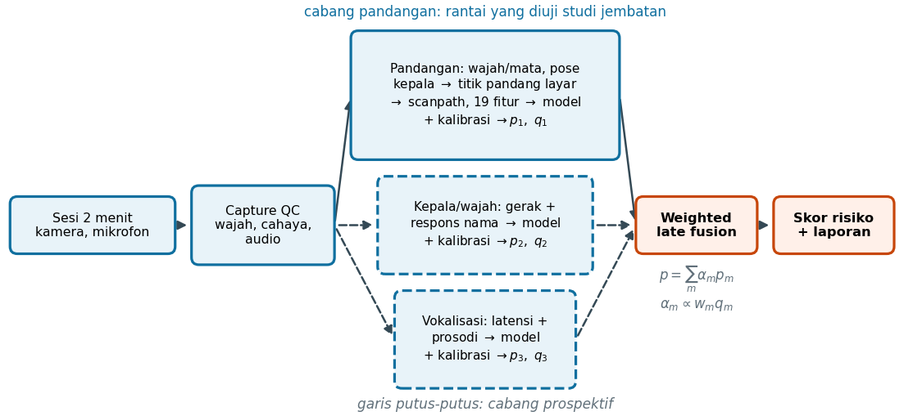
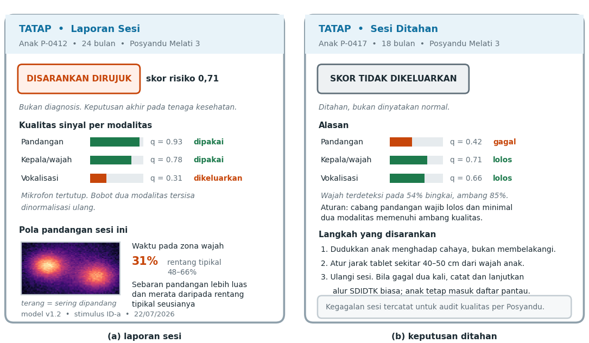
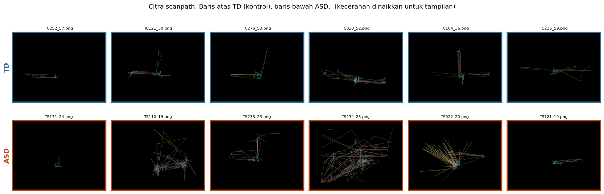
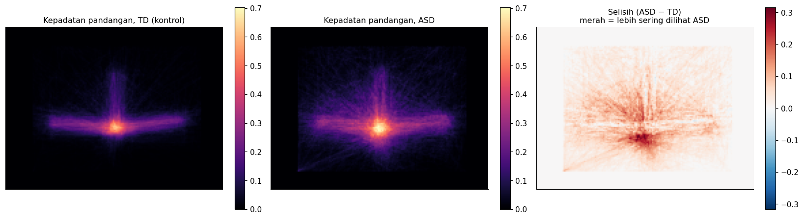
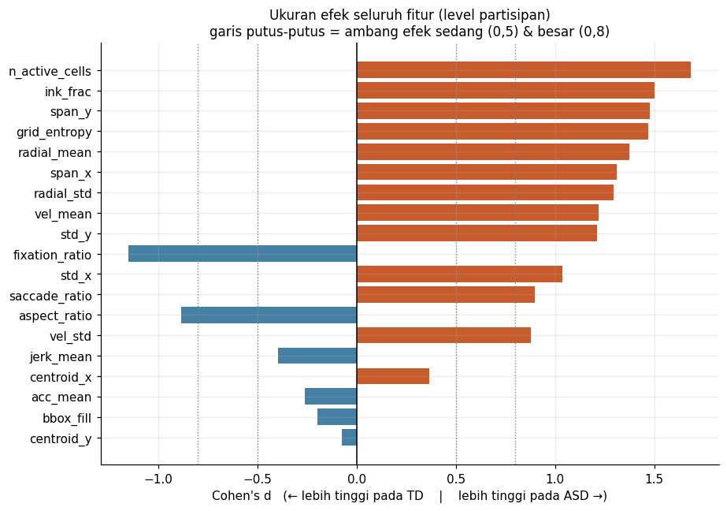
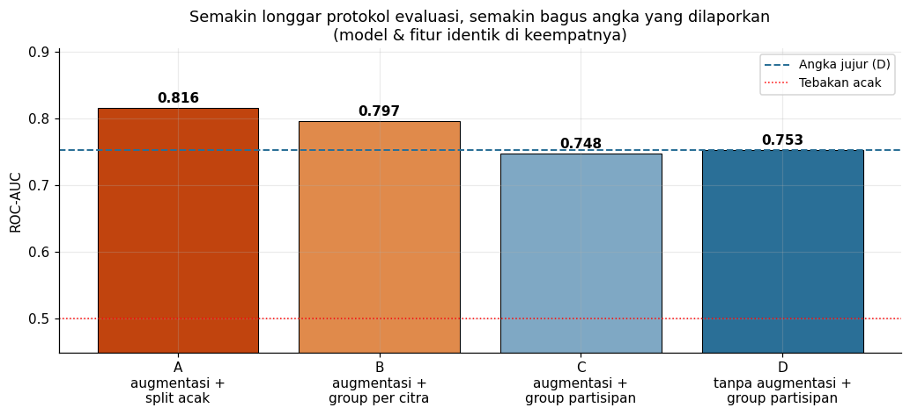

# Dataton 2026 - RIZZZ

> Babak penyisihan RISTEK Fasilkom UI Datathon 2026 (hasil akhir: 🥈 Juara 2 dari 250 tim). Repo asli: [patrick12354/Dataton-2026---Rizzz](https://github.com/patrick12354/Dataton-2026---Rizzz)

Repository solusi tim **RIZZZ** dari Universitas Airlangga untuk Dataton 2026.

Anggota tim:

- Timotius Christopher Patrick Sihombing
- Raphael Angelo Adikara Purnama
- Aqila Malfa Zahira

Repository ini memuat seluruh deliverable preliminary round: **AI Product Concept Paper** (bobot 60%) beserta proof of concept-nya, dan dua task Kaggle (bobot 40%) yaitu **City Network Traffic Forecasting** dan **Wikipedia Next Click Prediction**.

## Ringkasan Hasil

| Deliverable | Solusi final | Validasi utama | Hasil |
|---|---|---|---|
| Concept Paper - TATAP | Triase skrining ASD berbasis pandangan, weighted late fusion multimodal | GroupKFold per partisipan, unit anak | AUC anak **0,845** (CI 95% 0,730–0,944) |
| Task 1 - City Network Traffic Forecasting | Direct Low-Rank Regression + Directed Residual-GNN | MSE 31.1223 (development OOF) | **36.12 MSE** (public LB) |
| Task 2 - Wikipedia Next Click Prediction | OCR graph + shortest-path routing + semantic tie-break + discounted reachability | 77.62% top-1 grouped OOF | **0.768 accuracy** (public LB) |

Concept paper final: [Rizzz_ConceptPaper.pdf](project/paper/Rizzz_ConceptPaper.pdf).

Writeup final kedua task Kaggle tersedia dalam format PDF dan DOCX:

- [Task 1 - City Network Traffic Forecasting (PDF)](writeups/Rizzz_City%20Network%20Traffic%20Forecasting_Writeup.pdf)
- [Task 1 - City Network Traffic Forecasting (DOCX)](writeups/Rizzz_City%20Network%20Traffic%20Forecasting_Writeup.docx)
- [Task 2 - Wikipedia Next Click Prediction (PDF)](writeups/Rizzz_Wiki%20Article%20Next%20Click%20Prediction_Writeup.pdf)
- [Task 2 - Wikipedia Next Click Prediction (DOCX)](writeups/Rizzz_Wiki%20Article%20Next%20Click%20Prediction_Writeup.docx)

## Struktur Repository

```text
.
├── project/                  # AI Product Concept Paper (TATAP)
│   ├── AGENTS.md             # konteks, keputusan, insight log, dan status pengerjaan
│   ├── penjelasan_lomba.md   # ringkasan aturan dan rubrik concept paper
│   ├── riset_impact.md       # angka bersumber untuk Introduction & Literature Review
│   ├── poc_eyetracking.ipynb # notebook proof of concept eye-tracking
│   ├── poc_hasil.json        # angka hasil POC, ditimpa otomatis saat notebook dijalankan
│   ├── late_fusion.py        # weighted late fusion + quality gate
│   ├── test_late_fusion.py   # uji unit fusion, missing modality, pembelajaran bobot
│   ├── recompute_metrics.py  # reproduksi AUC level anak, nested CV, efek ukuran
│   ├── recompute_protokol.py # reproduksi dekomposisi protokol A–D
│   ├── figs/                 # gambar paper (PDF) + skrip generator + versi PNG
│   ├── paper/                # Rizzz_ConceptPaper.pdf + sumber LaTeX di sumber/
│   └── */                    # dataset lokal, tidak dilacak Git
├── day 1/
│   ├── dataset-task1/       # dataset lokal bersama, tidak dilacak Git
│   ├── patrick/             # eksperimen, notebook, laporan, dan submission
│   ├── raphael/             # workspace Raphael
│   └── malfa/               # workspace Malfa
├── day 2/
│   ├── dataset-task2/       # dataset lokal bersama, tidak dilacak Git
│   ├── patrick/             # eksperimen, notebook, laporan, dan submission
│   ├── raphael/             # workspace Raphael
│   └── malfa/               # workspace Malfa
└── writeups/                 # writeup final kedua task Kaggle (PDF dan DOCX)
```

Dataset dan bulk output berukuran besar tidak dilacak Git. Folder kosong menggunakan `.gitkeep` agar struktur workspace tim tetap tercatat.

## Concept Paper - TATAP

**TATAP** (Tes Atensi Tumbuh-kembang Anak berbasis Pandangan) adalah alat **triase skrining** risiko autisme di level Posyandu, bukan alat diagnosis. Anak menonton video adegan sosial sekitar dua menit di tablet Android biasa, kamera depan mengestimasi arah pandang, geometri scanpath diekstraksi menjadi fitur, dan keluarannya berupa skor risiko beserta rekomendasi rujukan. Keputusan klinis tetap berada di tangan tenaga kesehatan.

Positioning: M-CHAT adalah ceklis subjektif dengan false positive tinggi, sedangkan eye-tracker klinis akurat tetapi mahal dan hanya tersedia di klinik. Belum ada solusi yang berbasis webcam, dapat dioperasikan kader, dan dirancang untuk konteks Indonesia lewat jalur SDIDTK Kemenkes.

### Arsitektur

Tiga model unimodal berjalan terpisah, masing-masing menghasilkan probabilitas terkalibrasi `p_m` dan skor kualitas `q_m`. Quality gate membuang sinyal yang gagal, lalu weighted late fusion menormalisasi ulang bobot modalitas yang tersisa.



Garis penuh adalah cabang pandangan, satu-satunya rantai yang sudah diuji secara empiris. Garis putus-putus adalah cabang prospektif: gerak kepala/wajah dan vokalisasi. Bobot produksi hanya boleh dipelajari dari prediksi out-of-fold pada kohort prospektif berpasangan, dan fusi baru diadopsi jika mengungguli model unimodal terbaik.

**Aturan abstain:** sistem menahan keputusan bila cabang pandangan gagal ambang kualitas, atau bila kurang dari dua modalitas lolos ambang.

### Rancangan produk



Laporan menampilkan kualitas sinyal per modalitas, modalitas mana yang dikeluarkan, dan peta pandangan yang dapat dibaca kader. Layar kedua menunjukkan kasus keputusan ditahan, lengkap dengan alasan dan langkah perbaikan sesi.

### Proof of concept

POC berdiri di atas **autism eye tracking dataset** (Carette et al.): 547 citra scanpath dari 54 anak, 26 ASD dan 28 TD, dengan 19 fitur geometri. Satu anak menyumbang banyak citra, sehingga seluruh evaluasi memakai **GroupKFold per partisipan** dan unit keputusan adalah anak, bukan rekaman.



Perbedaan kelompok terlihat pada sebaran pandangan: kelompok ASD menyebar lebih luas dan lebih jarang bertahan pada zona wajah.



Temuan terkuat POC adalah **ukuran efeknya**, bukan angka akurasi model. Lima fitur teratas semuanya jauh di atas ambang efek besar (Cohen's d 0,8).



| Fitur | Cohen's d |
|---|---:|
| `n_active_cells` | 1,685 |
| `ink_frac` | 1,500 |
| `span_y` | 1,478 |
| `grid_entropy` | 1,471 |
| `radial_mean` | 1,374 |

Model utama dipilih **sebelum melihat hasil** (regresi logistik, pra-tetap) agar tidak ada seleksi model pada data validasi.

| Evaluasi | Nilai |
|---|---|
| AUC level anak (regresi logistik, pra-tetap) | **0,845** (CI 95% 0,730–0,944) |
| AUC level rekaman | 0,753 |
| Nested GroupKFold, level anak | 0,834 |
| Titik kerja level anak | sensitivitas 92,3%, spesifisitas 42,9% |
| PPV pada prevalensi 1% | 1,6% (62 rujukan per satu kasus) |
| Varians yang berasal dari identitas anak | 38,2% |

### Protokol evaluasi

Bagian ini adalah reimplementasi terkendali yang mengukur seberapa besar protokol evaluasi yang longgar menaikkan AUC. Model dan fitur identik pada keempat kondisi; yang berubah hanya cara data dipecah.



| Kondisi | Protokol | ROC-AUC |
|---|---|---:|
| A | augmentasi + split acak | 0,816 |
| B | augmentasi + group per citra sumber | 0,797 |
| C | augmentasi + group per partisipan | 0,748 |
| D | tanpa augmentasi + group per partisipan | **0,753** |

Dekomposisinya: kebocoran salinan augmentasi (A−B) menyumbang +0,019, hilangnya grouping per partisipan (B−C) menyumbang +0,048, dan augmentasi pada split yang benar (C−D) justru −0,005. Total penggelembungan A−D adalah +0,063, dan penyumbang terbesarnya adalah **mekanisme split**, bukan augmentasi.

Kurva belajar naik dari AUC 0,729 ke 0,766, tetapi kemiringan paruh akhirnya negatif (−0,024) karena set uji mengecil saat partisipan latih bertambah. Karena itu klaim "data lebih banyak pasti membantu" tidak dipakai; yang ditulis di paper adalah bahwa data yang ada belum cukup untuk menentukan batas atas performa pendekatan ini.

### Batas klaim

- Bukti empiris **hanya untuk cabang pandangan**. Cabang gerak, vokalisasi, dan fusi ditulis eksplisit sebagai prospektif dan menunggu validasi kohort berpasangan.
- `Multimodal Autism Dataset` bersifat **sintetis** dan sudah diverifikasi tidak dapat diprediksi (rata-rata fitur tiap modalitas identik di keempat kelas). Dataset itu hanya dipakai sebagai ilustrasi rancangan arsitektur, tidak pernah sebagai sumber metrik.
- TATAP bukan alat diagnosis. Seluruh keluaran adalah triase dan rujukan.

### Reproduksi POC

Semua angka di `project/poc_hasil.json` dapat direproduksi dari dataset eye-tracking:

```bash
cd project && python recompute_metrics.py && python recompute_protokol.py
```

Urutannya tidak boleh dibalik: `recompute_metrics.py` menulis ulang `poc_hasil.json`, lalu `recompute_protokol.py` menambahkan kunci `protokol` dan `dekomposisi` ke berkas yang sama.

Uji unit modul fusion:

```bash
cd project && python -m unittest test_late_fusion -v
```

Gambar paper diregenerasi dari skripnya:

```bash
cd project/figs && python generate_arsitektur.py && python generate_mockup.py
```

Notebook `poc_eyetracking.ipynb` perlu Restart Kernel + Run All agar output dan `poc_hasil.json` selaras. Kernel Jupyter didaftarkan sekali lewat `bash project/setup_kernel.sh`.

### Artefak utama Concept Paper

- [Berkas submit - Rizzz_ConceptPaper.pdf](project/paper/Rizzz_ConceptPaper.pdf)
- [Sumber LaTeX](project/paper/sumber/concept_paper.tex) (kompilasi minimal 3x agar sitasi ter-resolve)
- [Notebook POC eye-tracking](project/poc_eyetracking.ipynb)
- [Hasil POC dalam JSON](project/poc_hasil.json)
- [Implementasi weighted late fusion](project/late_fusion.py)
- [Riset dan angka Impact](project/riset_impact.md)
- [Aturan dan rubrik lomba](project/penjelasan_lomba.md)
- [Konteks, keputusan, dan insight log](project/AGENTS.md)

## Task 1 - City Network Traffic Forecasting

Task 1 memprediksi kecepatan **1.260 segmen jalan** pada tiga horizon:

- `h5`: +20 menit
- `h10`: +40 menit
- `h15`: +60 menit

Input mencakup 15 langkah history kecepatan, event text, directed adjacency matrix, dan metadata jalan. Metric kompetisi adalah **Mean Squared Error (MSE)**.

### Pendekatan final

Submission final menggunakan model hybrid dua tahap:

1. **Direct Low-Rank Regression (DirectLR)** sebagai anchor global. PCA whitened rank 48 dan Ridge memprediksi tiga horizon sekaligus secara direct.
2. **Directed Residual-GNN** mempelajari residual `truth - anchor`, dengan temporal convolution, road embedding, serta message passing tetangga masuk dan keluar secara terpisah.
3. Koreksi residual digabung menggunakan damping per horizon yang di-cross-fit. Acceptance gate otomatis kembali ke anchor jika koreksi neural tidak lolos audit stabilitas.

Validasi memakai grouped-day folds agar history dan target tetap berada dalam hari yang sama. Fold development dipisahkan dari locked audit untuk mencegah pemilihan model pada hari validasi yang terlalu mudah.

| Evaluasi | DirectLR anchor | Hybrid final | Gain |
|---|---:|---:|---:|
| Development OOF | 31.6777 | **31.1223** | 0.5554 |
| Locked audit | 32.5591 | **32.0414** | 0.5177 |
| Public leaderboard | - | **36.12** | - |

Residual model menang pada seluruh 28 hari validasi. Full run selesai dalam sekitar **7 menit 14 detik** pada satu Kaggle GPU T4 dengan seed 42.

### Artefak utama Task 1

- [Penjelasan task](day%201/patrick/penjelasan_lomba.md)
- [Source notebook V7](day%201/patrick/notebooks/source/datathon_task1_v7_directlr_residual_directed_gnn_source.ipynb)
- [Executed notebook V7](day%201/patrick/notebooks/runs/V7%20Final%20Notebook.ipynb)
- [Submission final V7](day%201/patrick/submissions/datathon_task1_v7_directlr_residual_gnn.csv)
- [Perbandingan final V5/V6/V7](day%201/patrick/reports/final_submission_comparison_v5_v6_v7.md)
- [Catatan eksperimen](day%201/patrick/codex.md)

## Task 2 - Wikipedia Next Click Prediction

Task 2 adalah single-step prediction pada navigasi Wikipedia: dari artikel saat ini dan artikel tujuan, model memprediksi link artikel yang akan diklik berikutnya. Metric kompetisi adalah **exact top-1 accuracy**.

### Pendekatan final

Screenshot diperlakukan sebagai representasi terstruktur halaman, bukan sebagai input klasifikasi gambar bebas:

```text
screenshot
  → deteksi region link biru + OCR
  → fuzzy title matching
  → directed graph 4.604 artikel
  → candidate masking dan shortest-path routing
  → semantic tie-break + discounted reachability
  → prediksi next article
```

Pipeline OCR memproses seluruh 4.604 halaman satu kali dan menghasilkan 121.460 region serta 93.256 directed edge. Recovery pada region yang gagal atau tergabung menambah 2.162 edge tanpa menggunakan label dan menaikkan candidate recall menjadi **99.39%**.

Validasi menggunakan 3-fold `GroupKFold` berdasarkan `target_article_id`, karena 360 target hanya muncul di train dan 240 target lain hanya muncul di test. Random row split akan membocorkan target yang sama ke train dan validation.

| Versi | Perubahan utama | Top-1 grouped OOF | Public LB |
|---|---|---:|---:|
| V1 | OCR graph + heuristic ranker | 65.09% | 0.637 |
| V2 | Hard-min shortest-path tie-break | 75.93% | - |
| V3 | OCR region recovery | 76.90% | - |
| V4 | Shortest-path mass | 77.36% | 0.767 |
| V5 | Semantic pair-ranker (MiniLM + LightGBM) | 77.49% | 0.767 |
| V6 (final) | Discounted reachability | **77.62%** | **0.768** |

V6 juga mencapai nested-selection accuracy 77.51%, top-3 94.4%, dan top-5 97.4%. Setelah cache OCR dan embedding tersedia, full V6 berjalan sekitar **1 menit 16 detik** pada CPU.

### Artefak utama Task 2

- [Penjelasan task](day%202/patrick/penjelasan_lomba.md)
- [Source notebook V6](day%202/patrick/notebooks/source/datathon_task2_v6_discounted_reachability_source.ipynb)
- [Executed notebook V6](day%202/patrick/notebooks/runs/V6%20Final%20Local%20Notebook.ipynb)
- [Submission final V6](day%202/patrick/submissions/datathon_task2_v6_discounted_reachability.csv)
- [Laporan diagnostics V6](day%202/patrick/reports/datathon_task2_v6_diagnostics.json)
- [Catatan eksperimen](day%202/patrick/codex.md)

## Menyiapkan Dataset

Dataset tidak dilacak oleh Git maupun Git LFS agar repository tetap ringan. Unduh dataset secara terpisah, lalu tempatkan pada:

```text
day 1/dataset-task1/
day 2/dataset-task2/
project/autism eye tracking dataset/    # TCImages/ dan TSImages/
project/Multimodal Autism Dataset/      # hanya ilustrasi arsitektur, sintetis
```

Sumber dataset concept paper:

- Eye-tracking scanpath (real, anchor teknis POC): <https://www.kaggle.com/datasets/aqilamalfa/autism-eye-tracking>
- Multimodal autism dataset (sintetis, tidak dipakai untuk metrik): <https://www.kaggle.com/datasets/kadhiravanucet/multimodal-autism-dataset>

Penamaan berkas eye-tracking mengikuti pola `T{C,S}###_PP.png`, dengan `PP` sebagai ID partisipan. `TCImages/` berisi 328 citra kontrol (TD) dan `TSImages/` berisi 219 citra ASD. Karena satu partisipan menyumbang banyak citra, split acak akan membocorkan data, jadi gunakan GroupKFold per `PP`.

Path input Kaggle yang digunakan notebook kedua task kompetisi:

```text
/kaggle/input/competitions/datathon-task-1/dataset-task1
/kaggle/input/competitions/datathon-task-2/dataset-task2
```

Notebook memiliki local fallback yang mencari folder dataset dari current directory dan parent directory. Untuk detail eksekusi dan dependency setiap versi, lihat Markdown serta output pada notebook terkait.
